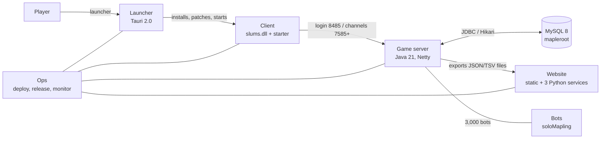

# SlumsMS architecture

An evidence-first map of the whole stack, written from the code on `164-archreview` (from `origin/release-1.6.4`,
commit a26fdb6c when this set was started). Every claim cites `file:line`; the graph, the release confs and the ticket
files are only used to locate things, never as proof on their own.

Six systems, one folder each. Read a system's `README.md` first (one page: purpose, parts, main flows, subsystem
table), then the subsystem file you need.

## Systems

| System | Folder | What it covers | Subsystems |
|---|---|---|---|
| Server | [server/](server/README.md) | the game server: boot, network, packet handlers, world/maps, WZ data, scripting, persistence, commands, config, mechanics, economy, companions, cash shop, fishing, achievements, check-in, families, site/dashboard, QA | 27 |
| Bots | [bots/](bots/README.md) | the AI players: population, tick engine, training, the decision core (planner/policy), grind, combat, travel, supply, gear, parties, quests, trade, social, chat, owned alts, observability | 18 |
| Client | [client/](client/README.md) | `slums.dll` and the starter exe: injector/hooks, HP/MP, resolution/D3D9, UI tweaks, crash guards, QA signals, build stamp, crash reports, config.ini, Custom.wz tooling, build/tests | 12 |
| Launcher | [launcher/](launcher/README.md) | Tauri launcher: manifest/release, channels/auth, install and packs, game config, play/launch, self-update/signing, UI, site/account, publishing | 9 |
| Website | [website/](website/README.md) | the public site and its services: build/checks, sections, login, market, report, exchange desk, board, deploy, privacy | 9 |
| Ops | [ops/](ops/README.md) | hosts, test deploy, release pipeline, migrations/rollback, client/launcher publishing, monitoring, backups, QA runner, safety guards | 9 |

## Conventions used in every subsystem file

- Paths are repo-relative. Server paths start at the server repo root (`src/main/java/...`), client paths at the
  client repo root (`src/hpmp.cpp`), launcher paths at the launcher repo root (`tauri/core/src/...`), website paths
  at the site repo root (`tools/site/...`).
- `Origin` is one of **base** (the upstream repack/Cosmic tree, unchanged), **modified**, or **custom**, and the
  evidence is in the line: the oldest commit (`03d13cb21` is the repack baseline), a byte-identical compare against
  `/root/workspace/cosmicms`, or a `tools/cosmicdiff/classifications.json` entry.
- `State` is **working**, **partial**, **broken** or **unknown**, with the evidence that supports it. "Working" needs
  a test or a running server behind it; a card in `STATUS-1.6.4.md` beats a guess.
- `NEW-FINDING:` marks something this review believes is wrong and no card covers. These are leads for Server Dev,
  not fixes; they are collected in [HOLES.md](HOLES.md).

## Switches

Switches are named in each subsystem's `## Switches`. The three places a switch can live:

1. `config.yaml` keys — fields of `src/main/java/config/ServerConfig.java`; unknown keys abort boot.
2. `-D` system properties read with `System.getProperty`, set by the unit file or `start-test.sh`.
3. Environment variables and files outside the repo (`/etc/...`, `*.env`) — named by path only, never read here.

Live's switch set is `docs/release/1.6.4.conf` (`SERVER_SET`, `UNIT_EDITS`). TEST's `start-test.sh` lives on
mapletest and was not read for this review, so where a subsystem says "TEST: unknown" that is why.

## What this review is not

- Not a fix list: no code was changed. [HOLES.md](HOLES.md) sorts every subsystem that is not plainly working, then
  lists each `NEW-FINDING` with `file:line`.
- Not complete: `## Open questions` in each file names what could not be determined from the code alone.
- Not runtime-verified: nothing was deployed, restarted or replayed. Statements about live behaviour come from the
  release confs and the status file, and are labelled as such.
