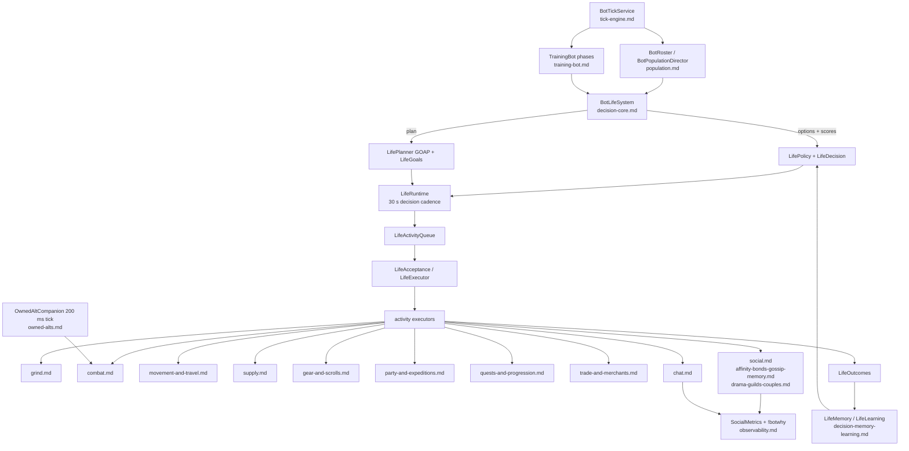

# Bots system

Thousands of headless characters that train, trade, chat and socialise in the same world as the real players.

## Purpose

Make the world feel populated and alive without real players: bots level up, farm, buy and sell, walk around towns,
party up, gossip, form crews and guilds, and occasionally marry. They run inside the game server process as ordinary
`Character` objects whose client is a `BotClient`; their ids start at 1,000,000,000 and
`Character.getClient().getPlayer()` is `null` for them (see the shared headless client in
`src/main/java/soloMapling/ArtificialPlayer/BotClient.java`).

About 1,035 files under `src/main/java/soloMapling/`, of which the bot packages are the majority: 86 top-level
classes in `ArtificialPlayer/`, 34 bot subpackages, plus `ArtificialPlayer/BotTypes/` (24 scripted bot kinds) and the
support packages.

## Parts

## Main flows

1. **Population.** `BotPopulationDirector` keeps the configured number of bots alive: it creates, logs in, places and
   logs out bots through `BotRoster`/`BotStore`/`BotClient` (`population.md`).
2. **Tick.** `BotTickService` runs the bot loop per bot on its own cadence, using `BotTiming`/`MethodScheduler`, and
   calls each bot's phase machine (`tick-engine.md`).
3. **Training.** `TrainingBot` is the per-bot state machine: walk to a spot, buff, attack, loot, pot, return to town,
   restock, change maps. Its phases call into the specialised packages (`training-bot.md`, `grind.md`, `combat.md`).
4. **Life decisions.** Every 30 s (with an interrupt margin) `LifeRuntime` builds a `Situation`, asks `LifePlanner`
   for a goal-ordered plan and `LifePolicy` for scored options across 16 activities, and submits the winner to
   `LifeActivityQueue` (`decision-core.md`).
5. **Execution and feedback.** `LifeAcceptance` tries the start; the executor runs it; `LifeOutcomes` reports the
   result; `LifeLearning` adjusts future weights and `LifeMemory` remembers what happened
   (`decision-memory-learning.md`).
6. **Social and chat.** `SocialMind`/`SocialDecider` decide to approach, talk, gift or group; `ChatTriage` and
   `BotChatActions` produce and route lines (`social.md`, `chat.md`); affinity, gossip, drama, crews, guilds and
   couples are their own packages.

## Subsystems

| Subsystem | File |
|---|---|
| Population: roster, director, store, client, lifecycle | `population.md` |
| Tick engine and schedulers | `tick-engine.md` |
| Training bot state machine | `training-bot.md` |
| Decision core: scoring, planning, queue, acceptance | `decision-core.md` |
| Decision memory, learning, outcomes | `decision-memory-learning.md` |
| Grinding, map choice, looting | `grind.md` |
| Combat: attacks, buffs, skills | `combat.md` |
| Movement and travel | `movement-and-travel.md` |
| Supply, pots, restock trips | `supply.md` |
| Gear, scrolling, star force | `gear-and-scrolls.md` |
| Party, PQ and expeditions | `party-and-expeditions.md` |
| Quests and progression | `quests-and-progression.md` |
| Trading and merchant bots | `trade-and-merchants.md` |
| Social mind, budget, intent book | `social.md` |
| Affinity, bonds, gossip, memory | `affinity-bonds-gossip-memory.md` |
| Drama, crews, guilds, couples | `drama-guilds-couples.md` |
| Chat: triage, replies, brains, claims | `chat.md` |
| Owned alts (companions) | `owned-alts.md` |
| Observability: `!botwhy`, `bot-life.json`, metrics | `observability.md` |

## Switches

The bot system has the largest switch surface in the repo. The main ones, with defaults and readers, are in
`../switches.md`; the live set is `docs/release/1.6.4.conf:271`. Brain and talk are **on by default** since 1.6.4 —
`-Dslums.botlife.enabled`, `-Dslums.botlife.execute`, `-Dslums.bottalk`, `-Dslums.crews` are false-only rollbacks
(`src/main/java/soloMapling/ArtificialPlayer/BotLifeSystem/LifeRuntime.java:93-102`,
`src/main/java/soloMapling/ArtificialPlayer/BotTalk.java:162`).

## How bots differ from players

They share the `Character` model and packet flow but not a socket: packets sent to them go nowhere, they never count
as connected players, and auto-QA uses `SyntheticClient` for the same reason. Any player-only logic must check
`instanceof BotClient` first. This invariant is documented in `../bots/population.md` and enforced ad hoc where
handlers touch `getClient().getPlayer()`.
