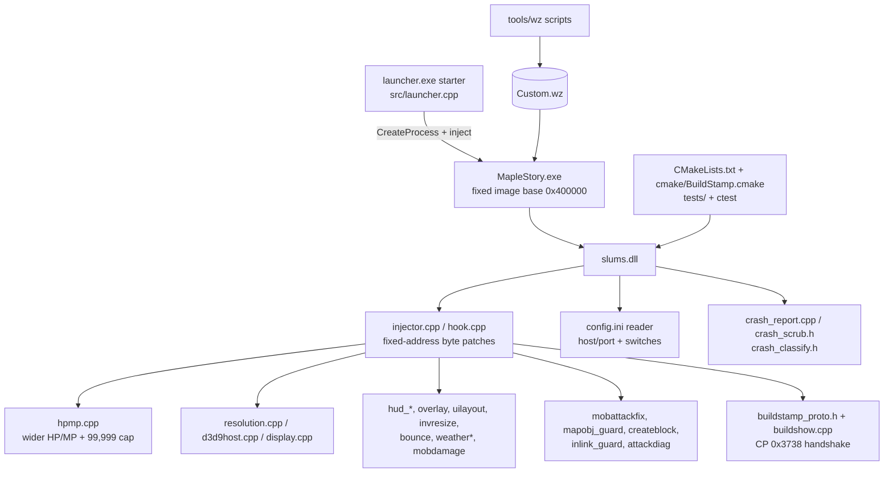

# Client system

`slums.dll`: a native DLL injected into the base v83 game client (`MapleStory.exe`), plus the small starter exe and
the data tools that build its custom archives.

## Purpose

The client cannot be rebuilt from source (it is a 2008-era binary), so every change is a byte patch, a code cave or
a hook at a fixed address, applied by the DLL at startup. The DLL also carries the launcher handshake, the wider
HP/MP bars, the UI tweaks, the rebuild and crash-classification hooks, and the QA signal channel used by the
client-MCP QA worker.

Repo: `/root/work/client/src-164-data` (branch of the client line; `VERSION` file currently `1.6.4-rc3`). Source is
flat under `src/` — about 150 source files plus headers, roughly 429 tracked `.cpp`/`.h` files in the tree — and is
built with CMake + MSVC Release on the owner's Windows box, not on this host.

## Parts

## Main flows

1. **Start.** The launcher writes `config.ini`, starts the client and injects `slums.dll` before the client reaches the
   login screen (`exe-and-starter.md`).
2. **Patch.** The DLL verifies the exe (sha256 and image base), then applies its patch tables in a fixed order; the
   verify pass runs last and fails loudly if a site does not match (`injector-and-hooks.md`, `hpmp.md`).
3. **Handshake.** `buildstamp_proto.h` sends the build number in CP `0x3738` before the password packet; the server's
   `ClientVersionGate` refuses builds below `MIN_CLIENT_BUILD` (`build-stamp-and-version.md`).
4. **Play.** Resolution/D3D9 hosting, HUD meters, overlays and layout fixes run from their hooks; every optional
   feature is switched in `config.ini` (`resolution-and-d3d9.md`, `ui-tweaks.md`, `config-ini.md`).
5. **Fail safe.** Crash guards absorb the known bad mob attacks, map-object and block-create paths and write a
   scrubbed crash report (`crash-guards.md`, `crash-report.md`).
6. **QA.** The QA build emits signals the client-MCP worker reads; those signals are what the client-side auto-QA
   checks assert on (`qa-signals.md`).

## Subsystems

| Subsystem | File |
|---|---|
| Starter exe and process creation | `exe-and-starter.md` |
| Injector, hook tables, patch order | `injector-and-hooks.md` |
| Wider HP/MP and the 99,999 cap | `hpmp.md` |
| Resolution, D3D9 host, display policy | `resolution-and-d3d9.md` |
| UI tweaks: HUD, overlay, layout, inventory, bounce, weather, mob damage | `ui-tweaks.md` |
| Crash guards: mob attacks, map objects, block create, inlink | `crash-guards.md` |
| QA signals for the client-MCP worker | `qa-signals.md` |
| Build stamp and version gates | `build-stamp-and-version.md` |
| Crash report and classification | `crash-report.md` |
| `config.ini` keys | `config-ini.md` |
| `Custom.wz` and the data tools | `custom-wz-and-data-tools.md` |
| Build, packaging and tests | `build-and-tests.md` |

## Switches

Almost everything is a `config.ini` key under `[config]`, read once at startup; `host`/`port` are resolved once and
baked into the connection. There is no `-D` equivalent: a feature is either compiled in (CMake option) or switched at
runtime by the ini. Historical note: the HP/MP patch is unconditional in the current source
(`src/CMakeLists.txt:21`), so every build carries the 4-byte HP/MP change and may use build numbers ≥ 10600
(`hpmp.md`).

## Invariants

- Patch sites are addressed by VA and must be byte-verified against the stock exe before use
  (`src/patch_common.h`, `src/checked_hook.h`); image base is `0x400000` and the exe sha256 is pinned per patch table.
- The DLL must never trust a hook that failed to install; the verify mode is run as the last step and reports the
  table (`src/hook.h:147-148`, `:303`).
- Incoming values that the client would store in a 2-byte field are only widened where the patch table widens the
  decoder — anything else must be clamped (`hpmp.md`, "checksum 0 means raw int").

## What this folder cannot tell you

The client is only tested on the owner's Windows machine through the client-MCP QA client; nothing in this repo runs
the game. Gameplay claims in these files are read from code, not observed in a session.
