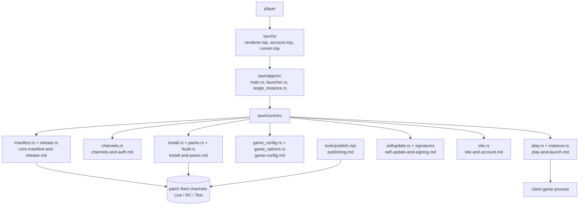

# Launcher system

The Tauri 2.0 launcher: installs and updates the game, writes the client's `config.ini`, signs in, and starts the game.

## Purpose

Give players one signed exe that can bootstrap a fresh install, keep it patched and start the game with the right
server and options — without exposing the patch site's key material or letting a half-updated install run. Rust core
in `tauri/core`, Tauri app shell in `tauri/app`, HTML/JS UI in `tauri/ui`.

Repo: `/root/work/launcher-165-server`. The Windows exe is built on the owner's machine; this host holds the source,
the tests (`npm test`, `cargo test -p slums-core`) and the signing key (path only:
`/root/.config/slumsms-launcher/tauri-signing.key`, never read).

## Parts

## Main flows

1. **Start and channel.** The launcher reads its settings, picks a channel (Live, RC, Test), and fetches the channel
   manifest with its access key (`channels-and-auth.md`, `core-manifest-and-release.md`).
2. **Update itself.** If the manifest names a newer launcher, it downloads it, verifies the signature and swaps itself
   in (`self-update-and-signing.md`).
3. **Install/repair.** `install.rs` compares the manifest against local file hashes, downloads missing or changed
   packs and applies them atomically (`install-and-packs.md`).
4. **Write game config.** `game_config.rs` merges the launcher's options into the client's `config.ini`, preserving
   keys the player set by hand (`game-config.md`).
5. **Play.** `play.rs` starts the client process with the right working directory, single-instance handling and
   build-stamp expectations (`play-and-launch.md`).
6. **Account and site.** Sign-up, login and news come from the site service (`site-and-account.md`,
   `../website/login-service.md`).

## Subsystems

| Subsystem | File |
|---|---|
| Manifest, release and client-build metadata | `core-manifest-and-release.md` |
| Channels and access keys | `channels-and-auth.md` |
| Install, packs, hashing, atomic apply | `install-and-packs.md` |
| `config.ini` merge and game options (b301) | `game-config.md` |
| Play, launch, instances | `play-and-launch.md` |
| Self-update and signing | `self-update-and-signing.md` |
| UI layer | `ui.md` |
| Site and account integration | `site-and-account.md` |
| Publishing pipeline | `publishing.md` |

## Switches

The launcher's own settings live in its config/settings files (`tauri/core/src/settings.rs`, `config.rs`); there is no
`-D` surface. Channels are Live `/srv/slums-patch/` (player key), Test `/launcher-test/` and RC `/launcher-rc/` (dev
key only) — see `docs/architecture/ops/hosts.md` for the host table, and `../ops/client-and-launcher-publishing.md`
for the server-side pipeline that fills those directories.

## Invariants

- A published Live client layer must point at the live host and port; the publishing tools refuse otherwise
  (`publishing.md`).
- Self-update is signature-checked before the swap (`self-update-and-signing.md`).
- `config.ini` keys the player set are preserved across merges (`game-config.md`).
- The launcher never writes outside its own app data directory and the game folder (`fsutil.rs`).
