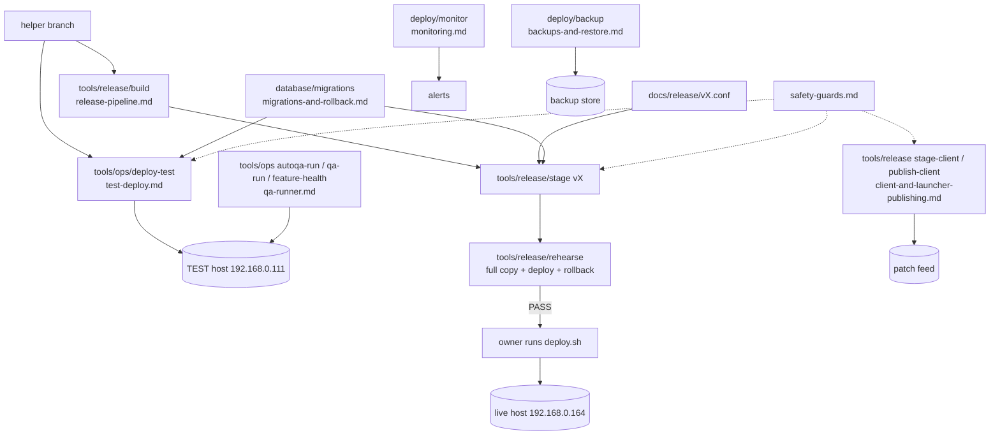

# Ops system

Everything an operator or an agent touches outside the code: hosts, deploys, releases, backups, monitoring and the QA
tooling that reaches a server.

## Purpose

Get a build from a branch to the TEST box safely, and from there to live only when the owner says so, with backups,
rollback, monitoring and a release record for each step. These files document the scripts as written, including where
a guard is only a convention.

## Parts

## Main flows

1. **TEST.** `tools/ops/deploy-test` builds, diffs against `Server/DEPLOYED_COMMIT`, backs up, copies the jar and data
   files, applies migrations, restarts the unit and fails if the boot logs an error (`test-deploy.md`).
2. **Release.** `build` → `stage <version>` (needs `docs/release/<version>.conf`) → `rehearse <version>` against a
   full copy of live → the owner runs `deploy.sh` on the live host (`release-pipeline.md`).
3. **Migrations.** Numbered SQL with a mandatory rollback, an idempotent ledger and a list per release
   (`migrations-and-rollback.md`).
4. **Publishing.** Client and launcher artefacts go out per channel with a hash-diff rule
   (`client-and-launcher-publishing.md`).
5. **Watch and restore.** Monitoring units read health files and logs; nightly backups and a scheduled restore drill
   prove the backups (`monitoring.md`, `backups-and-restore.md`).
6. **QA.** The QA tools start, collect and prove runs on TEST (`qa-runner.md`).

## Subsystems

| Subsystem | File |
|---|---|
| Hosts, units, ports, trust boundaries | `hosts.md` |
| TEST deploy | `test-deploy.md` |
| Release pipeline and conf schema | `release-pipeline.md` |
| Migrations and rollback | `migrations-and-rollback.md` |
| Client and launcher publishing (server side) | `client-and-launcher-publishing.md` |
| Monitoring and dashboard | `monitoring.md` |
| Backups and restore drill | `backups-and-restore.md` |
| QA runner tools | `qa-runner.md` |
| Safety guards | `safety-guards.md` |

## Switches

`SLUMS_TEST_HOST` (default `192.168.0.111`) is the only environment variable the TEST tools need; release manifests
carry the rest of the per-version configuration in `docs/release/<version>.conf` (`SERVER_SET`, `UNIT_EDITS`, migration
list). Secret material is always a file path, never a value: patch access keys, signing keys, webhook URLs, DB
passwords.

## Invariants

- Live is owner-gated: no script in these tools deploys to live by itself (`safety-guards.md` names the enforcement
  points and the gaps).
- `rehearse` must PASS before a release is staged for live (`release-pipeline.md`).
- Every migration is idempotent and has a rollback (`migrations-and-rollback.md`).
- A Live client layer must point at the live host and port (`client-and-launcher-publishing.md`).
