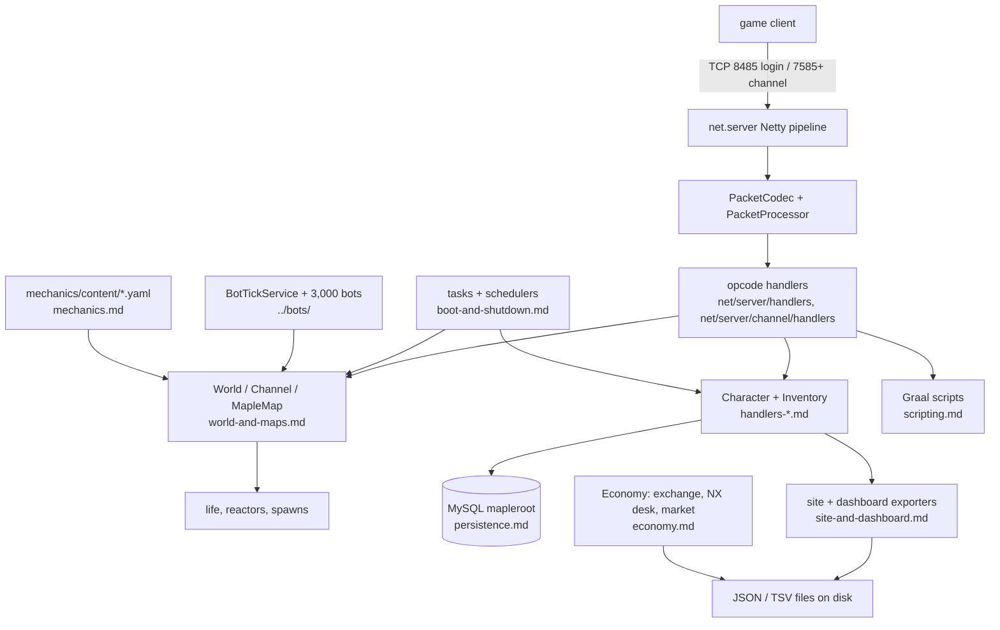

# Server system

The game server: one JVM process (`Cosmic.jar`) that holds the world, all channels, every connected player and all
bot characters. This page is the map; each subsystem has its own file in this folder.

## Purpose

Serve the base v83 protocol to real clients and to headless bots from a single process: authenticate (separately in
the login server), place characters on maps, run combat, items, shops, quests, timers and content, save everything to
MySQL, and expose JSON/TSV files to the website and dashboard. Roughly 2,100 Java files live under
`src/main/java`; about half (`soloMapling/`, 1,035 files) is bot and solo-play code, documented in the `bots` system.

## Layout

| Package | Files | What |
|---|---|---|
| `src/main/java/client` | 362 | `Character`, `MapleClient`, inventory, skills, family, commands — the per-player model |
| `src/main/java/net` | 318 | Netty pipeline, one handler per opcode (`net/server/handlers` 26, `net/server/channel/handlers` 153), coordinators, tasks |
| `src/main/java/server` | 218 | `Shop`, `Trade`, `Storage`, `CashShop`, maps, partyquest, life, reports, checkin, gachapon |
| `src/main/java/constants` | 72 | opcodes and game constants |
| `src/main/java/tools` | 55 | `PacketCreator` (every outgoing packet) and helpers |
| `src/main/java/scripting` | 28 | Graal script managers (NPC, portal, reactor, event) |
| `src/main/java/provider` | 15 | WZ data providers (`provider/wz`) |
| `src/main/java/config` | 4 | `ServerConfig`, YAML loading |
| `src/main/java/database` | 3 | `DatabaseConnection` (Hikari), migration helpers |
| `src/main/java/service` | 2 | service discovery |
| `src/main/java/soloMapling` | 1,035 | bots, companions, mechanics, economy, site export, QA — see `../bots/` and the dedicated files here |

## Parts

## Main flows

1. **Login.** Client connects to the login port, `net/server/handlers/login` validates the password against
   `accounts`, checks the client build stamp (`ClientVersionGate`), issues a session key and hands the client a world
   and channel list (`handlers-login.md`).
2. **Enter world.** The channel connection is matched by the session coordinator, `Character` is loaded from the DB,
   placed on its saved map, and the map sends spawn packets (`world-and-maps.md`, `handlers-movement.md`).
3. **Gameplay.** Each opcode is decoded by `PacketProcessor`, dispatched to its handler, which mutates `Character`,
   `MapleMap` and inventory state and broadcasts `PacketCreator` messages (`handlers-combat/…`).
4. **Ticks.** A fixed set of `net/server/tasks/*Task` timers plus per-map schedulers drive saving, respawns,
   merchants, weddings, fishing and daily resets (`boot-and-shutdown.md`).
5. **Save and shut down.** `Server.shutdownInternal` saves real players first, then bots within a budget, then shuts
   the world down; the periodic autosaver writes the rest (`persistence.md`).

## Subsystems

| Subsystem | File |
|---|---|
| Boot, timers, shutdown | `boot-and-shutdown.md` |
| Config (`config.yaml` + `-D`) | `config.md` |
| Netty, codec, opcode dispatch | `network-and-packets.md` |
| Handlers: login | `handlers-login.md` |
| Handlers: movement and map transfer | `handlers-movement.md` |
| Handlers: combat and damage | `handlers-combat.md` |
| Handlers: inventory, items, drops | `handlers-inventory.md` |
| Handlers: NPC and shops | `handlers-npc-shops.md` |
| Handlers: party, guild, alliance, family | `handlers-party-guild.md` |
| Handlers: trade, storage, merchants, duey | `handlers-trade.md` |
| Handlers: cash shop | `handlers-cashshop.md` |
| Handlers: quests | `handlers-quests.md` |
| World, channel, maps, life, reactors | `world-and-maps.md` |
| WZ data providers, portal fixes | `wz-data.md` |
| Graal scripting and event instances | `scripting.md` |
| Commands and GM levels | `commands.md` |
| Persistence, saves, migrations | `persistence.md` |
| Content engine (PQ/boss YAML) | `mechanics.md` |
| Economy (exchange, NX desk, market) | `economy.md` |
| Companions (owned alts, weddings) | `companions.md` |
| Cash shop | `cashshop.md` |
| Fishing | `fishing.md` |
| Achievements | `achievements.md` |
| Daily check-in | `checkin.md` |
| Families | `families.md` |
| Public site, dashboard, inspect API | `site-and-dashboard.md` |
| `!qa` and auto-QA | `qa-and-autoqa.md` |

## How the pieces are switched on

Three homes, all documented in `../switches.md`: fields in `config.yaml` (`ServerConfig`), `-D` system properties read
with `System.getProperty`, and files/env named by path. The live set is 69 `-D` flags in
`docs/release/1.6.4.conf:271` (`UNIT_EDITS`). TEST's `start-test.sh` is not in this repo, so TEST's exact flag set is
unknown here.

## What this folder does not cover

Bots and companion AI (`../bots/`), the client (`../client/`), launcher, website and operations. Cross-system
conclusions and open findings are collected in `../HOLES.md`.
