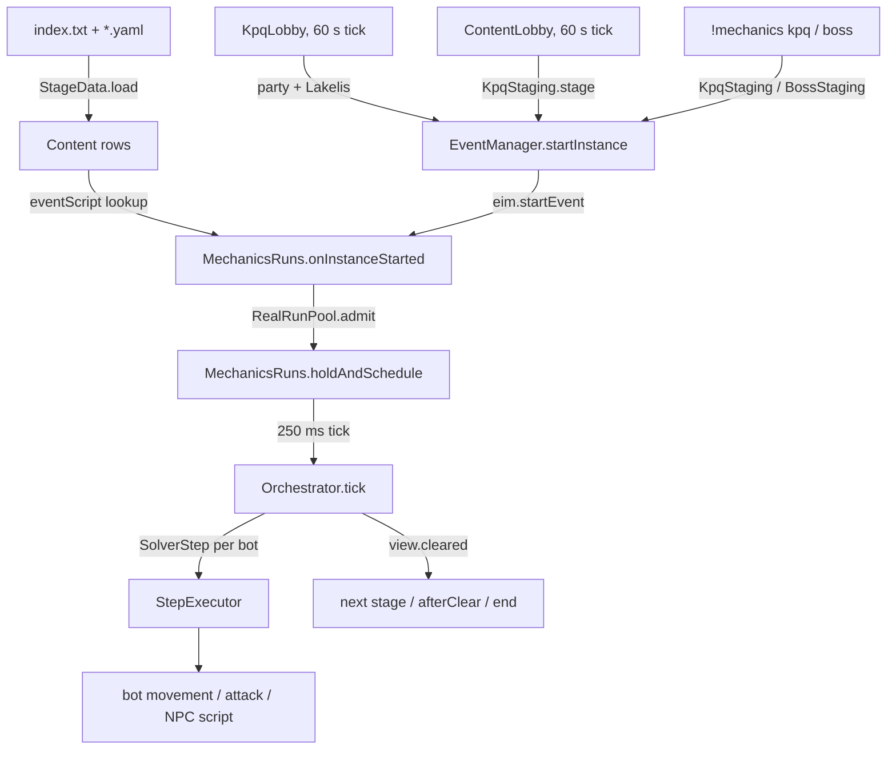

# Mechanics

## Purpose

Mechanics is the subsystem that lets server-side bots actually *play* party quests and boss expeditions: it loads one
YAML row per piece of content, gets a party (or an expedition) of bots into the content's real script by talking to the
real NPC, then drives each bot — move, fight, loot, hit reactors, answer NPCs — on a 250 ms tick, following the
content's stages until the script says the stage cleared. Everything it does goes through the same `EventManager`,
`EventInstanceManager`, `MapleMap` and Graal scripts a player's party uses; the only thing that is new is who is
pressing the keys. It is entirely behind `-Dslums.mechanics` (off by default) and is the implementation of the L09 card
("Bots run party quests and boss expeditions: 57 mechanics rows", ticket 130).

## Entry points

| Entry | What it does | File:line |
|---|---|---|
| `Mechanics.enabled()` | master switch, `Boolean.getBoolean("slums.mechanics")` | src/main/java/soloMapling/mechanics/Mechanics.java:131 |
| `StageData.load()` | reads `content/index.txt` through `soloMapling.DataFiles` (or `-Dslums.mechanics.dir`) | src/main/java/soloMapling/mechanics/StageData.java:62-68 |
| `MechanicsRuns.onInstanceStarted(eim, expedition)` | the hook every event instance goes through; resolves the row and arms a run | src/main/java/soloMapling/mechanics/MechanicsRuns.java:534-592 |
| `EventManager` → `MechanicsRuns.onInstanceStarted(eim, true)` | after an expedition's `eim.startEvent()` | src/main/java/scripting/event/EventManager.java:506 |
| `EventManager` → `MechanicsRuns.onInstanceStarted(eim, false)` | after a party's `eim.startEvent()` | src/main/java/scripting/event/EventManager.java:657, :733 |
| `EventManager` → `MechanicsRuns.onQueueInstanceStarted(eim)` | world-queue instance (Guild Quest) → `LobbyWatch` | src/main/java/scripting/event/EventManager.java:581 |
| `KpqLobby.startIfEnabled()` | boot: the 1.6.1 Kerning PQ bot lobby (once a minute) | src/main/java/net/server/Server.java:1048 |
| `ContentLobby.startIfEnabled()` | boot: per-row PQ lobbies (all off by default) | src/main/java/net/server/Server.java:1049 |
| `!mechanics` / `!mech` (gm3) | GM staging; registered only with the master switch | src/main/java/client/command/CommandsExecutor.java:398-400 |
| `BossStaging.start(gm, type, bots)` | the only caller of a bot-captained expedition | src/main/java/soloMapling/mechanics/BossStaging.java:49-115 |
| `QueueStaging.start(...)` | guild-quest path through the world queue (test-only today) | src/main/java/soloMapling/mechanics/QueueStaging.java:146-250 |

## How it works

1. **Content rows load.** `StageData.load()` (src/main/java/soloMapling/mechanics/StageData.java:62-68) either lists
   `-Dslums.mechanics.dir` (`loadDir`, :113-145) or reads `content/index.txt` (`loadIndexed`, :74-105) and parses each
   name with the YAML reader (`parse`, :151-171), keying rows by `id`. 57 rows, 201 stages: 29 `kind: BOSS`, 28 `PQ`
   (docs/release/1.6.4.conf:42-45). A file with any problem is rejected whole and reported, the rest still load
   (src/main/java/soloMapling/mechanics/StageData.java:151-171).
2. **Something decides to start an instance.** Four paths do: `KpqLobby.tick()` forms a party of free bots standing in
   Kerning City and has its leader talk to Lakelis (src/main/java/soloMapling/mechanics/KpqLobby.java:108-161);
   `ContentLobby.tick()` does the same for 12 named PQ scripts by spawning fresh bots (src/main/java/soloMapling/mechanics/ContentLobby.java:108-168);
   `KpqStaging` spawns bots and either has a bot leader talk to the row's `entryNpc` or starts the instance directly for
   a GM (src/main/java/soloMapling/mechanics/KpqStaging.java:185-350); `BossStaging` spawns a crew on the recruit map and
   makes `ExpeditionBots.startAsCaptain` open the expedition (src/main/java/soloMapling/mechanics/BossStaging.java:57-115,
   src/main/java/soloMapling/ArtificialPlayer/BotPartySystem/ExpeditionBots.java:220).
3. **The event script starts the instance, and the hook arms a run.** `EventManager` calls
   `MechanicsRuns.onInstanceStarted(eim, expedition)` after `eim.startEvent()`
   (src/main/java/scripting/event/EventManager.java:506, :657, :733). It resolves the row by the script name —
   `rowsFor(event)` then `select(rows, eim.instanceMapIds())` (src/main/java/soloMapling/mechanics/MechanicsRuns.java:648,
   :662-681): one row wins outright, several rows are disambiguated by the instance's maps, and no evidence arms
   nothing and logs once (src/main/java/soloMapling/mechanics/MechanicsRuns.java:543-556).
4. **The switches are checked per row.** A `kind: BOSS` row asks `Mechanics.bossEnabledFor(content)` (boss switch AND the
   row's own flag); every other row asks `Mechanics.enabledFor(content)` (master switch AND the row's flag when it names
   one) — src/main/java/soloMapling/mechanics/MechanicsRuns.java:558-563,
   src/main/java/soloMapling/mechanics/Mechanics.java:186-209.
5. **A quota is taken before anything is driven.** A human in the instance gets `RealRunPool.exempt(HUMAN_PARTY |
   HUMAN_EXPEDITION)`; a bot-only instance asks `RealRunPool.get().admit(BOT_INSTANCE, content, 0)`
   (src/main/java/soloMapling/mechanics/MechanicsRuns.java:564-580, src/main/java/soloMapling/mechanics/RealRunPool.java:177,
   :200-215). With `-Dslums.mechanics.realruns` unset the cap is negative and every ask is admitted free
   (src/main/java/soloMapling/mechanics/RealRunPool.java:201-204).
6. **The run is built and the bots are taken over.** `MechanicsRuns.start(...)` funnels every overload into
   `start(eim, content, tier, perfect, budgetMs, firstStage, lastStage, ownsInstance, reporter, onEnd, admission)`
   (src/main/java/soloMapling/mechanics/MechanicsRuns.java:226-244) → `begin` (:245-297) builds one `RunMember` per
   instance player (BOT / OWNED_ALT / PLAYER), makes an `Orchestrator`, calls `o.start(content, tier, members)`
   (src/main/java/soloMapling/mechanics/Orchestrator.java:128-161) and hands over to `holdAndSchedule` (:300-328):
   `MechanicsHold.hold(botId)`, the bot's own brain stopped (`BotTypeManager.manuallyStopBot`), `GCMovement.stop`, one
   `RUN start …` report line, and a 250 ms fixed-delay tick (src/main/java/soloMapling/mechanics/MechanicsRuns.java:38,
   :300-328).
7. **Each tick asks the stage's solver what every bot should do.** `MechanicsRuns.tick` builds a `LiveStageView` over the
   `EventInstanceManager` and calls `Orchestrator.tick(run, view, now)`; whatever events the run recorded that tick are
   reported, each returned `SolverStep` is executed by `StepExecutor`, then `keepPhysics`, `upkeep`, `scaleRoom` and
   `releaseLostMembers` run (src/main/java/soloMapling/mechanics/MechanicsRuns.java:363-401). A throw is caught by
   `safeTick` and ends the run through `o.abort` (src/main/java/soloMapling/mechanics/MechanicsRuns.java:348-361).
8. **`Orchestrator.tick` is the state machine.** In order: after-clear handling (:235 → `afterClearTick` :528-584);
   member-lost detection for anyone no longer in the stage, and — 1.6.4 — for a bot that is dead
   (src/main/java/soloMapling/mechanics/Orchestrator.java:239-256); the revive pause (:263-268, :712); stray notes (:270);
   the clear branch (:272-315); the budget (:318-338); unfilled roles for 60 s → abort (:336-348); then per-bot planning
   and `solver.next(view, member)` (:350-400), where an `Abandon` step fails the run instead of spinning.
9. **A clear advances the run.** On `view.cleared()`: a conditional `Branch` may jump (or end), `loopTo` sends the run
   back, otherwise the stage advances by one with fresh role claims and a `stage N: …` note; when the last playable stage
   is done the run is `markCleared`, and if the row has an `afterClear` block and the run reached the row's real last stage
   it enters the after-clear phase ("prizes, bonus and out"), else it ends `"cleared"`
   (src/main/java/soloMapling/mechanics/Orchestrator.java:272-315).
10. **After-clear: prize, bonus, out.** `afterClearTick` sends the bots to `rewardNpc` on `rewardMap` for the prize
    (`Converse`, with a 60 s give-up), then to `bonusMap` to dwell `bonusMin…bonusMax` seconds and talk to `exitNpc`, or
    waits if there is no such block (src/main/java/soloMapling/mechanics/Orchestrator.java:528-584, constants :43, :46).
11. **The run ends and everything is handed back.** `MechanicsRuns.finish` → `endRun` cancels the tick, deregisters the
    `Active`, releases every hold, restarts every brain it stopped, closes the instance when the run owned it, records the
    outcome and reports `RUN end …` (src/main/java/soloMapling/mechanics/MechanicsRuns.java:715-765, `closeInstance` :796,
    `endInstance` :854). The pool place is released in `finish`'s `finally` (:715-726).
12. **Bots that leave the run get their own brain back** mid-run: `releaseLostMembers` releases the hold and restarts
    `BotSM` for any bot the run has dropped, unless the run is pausing for exactly that member
    (src/main/java/soloMapling/mechanics/MechanicsRuns.java:403-423).

### How a bot gets into content, per path

| Path | Who starts it | Evidence |
|---|---|---|
| L09 "bots stand in PQ lobbies" | `LifePq` sends a bot to the kpq/lpq/opq town map in its level band during PQ hours; a player or bot leader then invites it. No mechanics code involved | src/main/java/soloMapling/ArtificialPlayer/BotLifeSystem/LifePq.java:28-31, :48-57 |
| Kerning lobby (1.6.1, live) | `KpqLobby` — ≤ `-Dslums.mechanics.lobbyRuns` (2) bot-only runs world-wide, one start per minute, one party per channel, bots yield to a real party | src/main/java/soloMapling/mechanics/KpqLobby.java:40-43, :68, :108-161, :286-300 |
| Per-row lobby (1.6.4, off) | `ContentLobby` — one start per tick across 12 scripts, one per channel | src/main/java/soloMapling/mechanics/ContentLobby.java:52-54, :108-168 |
| GM staging | `!mechanics kpq …` → `KpqStaging.stage`; `!mechanics boss <TYPE> [n]` → `BossStaging.start` | src/main/java/client/command/commands/gm3/MechanicsCommand.java:181-285 |
| Real player's party/expedition | the player starts it normally; the hook arms a run for the bots and owned alts already inside | src/main/java/soloMapling/mechanics/MechanicsRuns.java:534-592 |
| World queue (guild quest) | `onQueueInstanceStarted` → `LobbyWatch` polls until the join window closes, then arms | src/main/java/soloMapling/mechanics/MechanicsRuns.java:594-614, src/main/java/soloMapling/mechanics/LobbyWatch.java:45-90 |

Card L14 (`/root/work/STATUS-1.6.4.md:105`) was checked: it is the relationship window (`@bonds`), not mechanics. Nothing in this
subsystem serves it.

### Content rows

All 57 rows are listed in `src/main/java/soloMapling/mechanics/content/index.txt:3-59` (header :1-2). "Entry" is the
row's `recruitMap`; "NPC" its `entryNpc` (0 = the row is entered some other way, e.g. a boss altar).

| content id | yaml | kind | entry map | NPC | stages | solver(s) in stage order | row switch |
|---|---|---|---|---|---|---|---|
| kpq | kpq.yaml | PQ | 103000000 | 9020000 | 5 | question-coupons, combination ×3, kill-collect-hand-in | — |
| zakum | zakum.yaml | BOSS | 211042400 | 0 | 1 | boss-phases | — |
| horntail | horntail.yaml | BOSS | 240050400 | 0 | 3 | boss-phases ×3 | — |
| zakum-chaos | zakum-chaos.yaml | BOSS | 211042400 | 0 | 1 | boss-phases | `slums.chaos.zakum` |
| opq | opq.yaml | PQ | 200080101 | 2013000 | 8 | opq-clouds, kill-collect-hand-in, opq-sweep, opq-lobby, opq-sealed, opq-subroom, opq-levers, opq-statue | `slums.mechanics.opq` |
| lpq | lpq.yaml | PQ | 221024500 | 2040034 | 9 | lpq-farm ×7, lpq-combo, lpq-farm | `slums.mechanics.lpq` |
| hpq | hpq.yaml | PQ | 100000200 | 1012112 | 2 | hpq-beds, kill-collect-hand-in | `slums.mechanics.hpq` |
| cafepq1…cafepq6 | cafepq1.yaml … cafepq6.yaml | PQ | 193000000 | 1052013 | 1 each | cafepq-coupons | `slums.mechanics.cafepq` |
| ludimazepq | ludimazepq.yaml | PQ | 220000000 | 9103001 | 1 | ludimaze | `slums.mechanics.ludimazepq` |
| piratepq | piratepq.yaml | PQ | 251010404 | 2094002 | 1 | pirate-quest | `slums.mechanics.piratepq` |
| treasurepq | treasurepq.yaml | PQ | 674030100 | 9220018 | 1 | treasure-chest | `slums.mechanics.treasurepq` |
| dellibattle | dellibattle.yaml | PQ | 925010200 | 2095000 | 1 | delli-hold | `slums.mechanics.dellibattle` |
| magatiapq | magatiapq.yaml | PQ | 261000021 | 2112003 | 6 | magatia-books, fight-room, reactor-count, magatia-files, magatia-climb, summoned-boss | `slums.mechanics.magatiapq` |
| magatiapqz | magatiapqz.yaml | PQ | 261000011 | 2112004 | 6 | as magatiapq | `slums.mechanics.magatiapqz` |
| ellinpq | ellinpq.yaml | PQ | 300030100 | 2133000 | 6 | fight-room, reactor-state, summoned-boss, ellin-marbles, ellin-stone, fight-room | `slums.mechanics.ellinpq` |
| cwkpq | cwkpq.yaml | PQ | 610030020 | 9201113 | 4 | cwkpq-sigils, cwkpq-door, cwkpq-sigils, cwkpq-boss | `slums.mechanics.cwkpq` |
| bossrush0…bossrush7 | bossrush0.yaml … bossrush7.yaml | PQ | 970030000 | 9000037 | 6 each | fight-room ×6 | `slums.mechanics.bossrush` |
| zakumpq | zakumpq.yaml | PQ | 211042300 | 2030008 | 59 | zakum-mines ×59 | `slums.mechanics.zakumpq` |
| guildquest | guildquest.yaml | PQ | 101030104 | 9040000 | 7 | gq-lobby, gq-earring, gq-statues, gq-spears, gq-vassals, gq-maze, gq-boss | `slums.mechanics.guildquest` |
| dunas / aufheben / oberon / bergamot / nibelung | same-named yaml | BOSS | 240070302 / 240070402 / 240070502 / 240070202 / 240070602 | 0 | 1 each | boss-phases | — |
| maha / castellan / papulatus / krexel | same-named yaml | BOSS | 140000000 / 800040401 / 220080000 / 541020700 | 0 | 1 each | boss-phases | — |
| showa / balrog / scarga / elemental | same-named yaml | BOSS | 801040004 / 105100100 / 551030100 / 220050300 | 0 | 1 each | boss-phases | — |
| pinkbean / latanica / magnus | same-named yaml | BOSS | 270050000 / 541010060 / 401053002 | 0 | 1 each | boss-phases | — |
| guardiannex1…guardiannex6 | guardiannex1.yaml … guardiannex6.yaml | BOSS | 240070000 | 0 | 1 each | boss-phases | — |
| nwill | nwill.yaml | BOSS | 450007240 | 3003560 | 1 | boss-phases | `slums.mechanics.nwill` |
| nlucid | nlucid.yaml | BOSS | 450003600 | 9010100 | 1 | boss-phases | `slums.mechanics.nlucid` |
| nverus | nverus.yaml | BOSS | 450011660 | 3003773 | 1 | boss-phases | `slums.mechanics.nverus` |
| ndarknell | ndarknell.yaml | BOSS | 450012600 | 3003806 | 1 | boss-phases | `slums.mechanics.ndarknell` |

Solver ids are the `public static final String ID` (or `id()`) of each class, registered by
`Orchestrator.allSolvers()` (src/main/java/soloMapling/mechanics/Orchestrator.java:58-135) — 40 solver instances. `ZakumMinesSolver` returns the literal `"zakum-mines"` from `id()` rather than a constant
(src/main/java/soloMapling/mechanics/ZakumMinesSolver.java:39-41).

## Data

### `content/index.txt` and the row schema

`StageData.loadIndexed` reads `index.txt` through `soloMapling.DataFiles::path` so a jar-only install finds the files; a
directory cannot be listed inside a jar (src/main/java/soloMapling/mechanics/StageData.java:57-60, :62-105). Names must
match `[a-z0-9][a-z0-9-]*\.yaml` (`FILE_NAME`, :55) or the row is reported as `index.txt: 'x' is not a stage-data file
name like kpq.yaml` (:86). Duplicate content ids across files are dropped with `"duplicate content id across files"`
(:143). `loadDir` sorts by file name so "the first row" means the same thing in every run (:120-132).

Row keys read by `readContent` (src/main/java/soloMapling/mechanics/StageData.java:165-180+): `id` (required), `name`
(required), `kind` (required enum `PQ|BOSS|JQ|EXPEDITION`), `eventScript`, `recruitMap` (0), `exitMap` (0), `minPlayers`
(1), `maxPlayers` (6), `minLevel` (1), `maxLevel` (200), `timeLimitMinutes` (0), `sources`, `stages`, `flag`,
`entryNpc` (0), plus the optional `tiers`, `afterClear`, `composition`, `queue` blocks. A row's `maxLevel` of 255 appears
in zakum.yaml:22.

Stage keys read by `readStage` (src/main/java/soloMapling/mechanics/StageData.java:377+): `stage`, `map`, `name`, `npc`,
`solver`, `roles`, `answers`, `objectives`, `positions`, `items`, `phases`, `combos`, `mobs`, `nextPortal`,
`summonProperty`, `spawnWaitSeconds`, `timeLimitMinutes`, `hitReactors`, `entryItems`, `maps`, `loopTo`, `onTimeLimit`,
`branches`. The `Stage` record carries exactly those fields (src/main/java/soloMapling/mechanics/MechanicsModel.java:330-336).

Only four rows declare difficulty tiers (`tiers:`) — kpq, lpq, opq, hpq; only `guildquest.yaml` declares `queue:` and
`composition:` (`guildquest.yaml:45-50`, :51-56); kpq and guildquest declare `afterClear:`
(`kpq.yaml:1-60`). Everything else is a plain stage list.

### Runtime state (not durable)

| State | Where | Notes |
|---|---|---|
| `MechanicsRuns.active` (per-instance `Active`) | src/main/java/soloMapling/mechanics/MechanicsRuns.java:53, :268 | in-memory only; one run per `EventInstanceManager` |
| `RealRunPool` leases + `wanting`/`lastReal` maps | src/main/java/soloMapling/mechanics/RealRunPool.java:159-232 | in-memory; capacity re-read every ask |
| `SimulatedRuns` rings / `RunSamples` | src/main/java/soloMapling/mechanics/SimulatedRuns.java:62-141, src/main/java/soloMapling/mechanics/RunSamples.java | in-memory |
| `RunOutcomes` ring (500) | src/main/java/soloMapling/mechanics/RunOutcomes.java:27 | "Not durable yet. The ring is lost on a restart" (javadoc :18) |
| `KpqLobby.refusedUntil`, `running` | src/main/java/soloMapling/mechanics/KpqLobby.java:51-53 | lost on restart, by design |

The subsystem writes nothing to MySQL. The content rows are read-only resources; the only persistent effect of a run is
whatever the content's own script does (items, EXP, boss drops).

## Switches

All mechanics switches are `-D` system properties: `src/main/java/config/ServerConfig.java` has no mechanics key (grep
for `mechanics` returns nothing), and the `SERVER_SET` block of docs/release/1.6.4.conf:201-215 is bot-population only.

| Switch | Default | Read at | What it does |
|---|---|---|---|
| `slums.mechanics` | off | Mechanics.java:20, :131 | the master switch; gates the hook, the lobbies, the GM command and every non-boss row |
| `slums.mechanics.boss` | off | Mechanics.java:27, :176 | arms the 29 `kind: BOSS` rows (docs/release/1.6.4.conf:47) |
| `slums.mechanics.<row-flag>` | off | Mechanics.java:196, :207 | per-family row switch; 20 distinct flags over 32 rows (opq, lpq, hpq, cafepq, ludimazepq, piratepq, treasurepq, dellibattle, magatiapq, magatiapqz, ellinpq, cwkpq, bossrush, zakumpq, guildquest, nwill, nlucid, nverus, ndarknell) — docs/release/1.6.4.conf:48-52 |
| `slums.chaos.zakum` | off | row flag on zakum-chaos.yaml; also read by autoqa (AutoQaCatalog.java:2220) and qa/BossRunScenarios.java:135 | the Chaos Zakum row (docs/release/1.6.4.conf:53) |
| `slums.bossfight.revivepause` | **off** in code, **on** in the release conf | RevivePause.java:25, :37 | a boss run pauses for a lost member instead of failing; with it off a bot death ends the run (docs/release/1.6.4.conf:54-62) |
| `slums.bossfight.revivepause.ms` | 5 min (`DEFAULT_WINDOW_MS`, RevivePause.java:27) | RevivePause.java:26, :43 | pause window; per-row override `….ms.<row id>` |
| `slums.mechanics.lobby` | off | KpqLobby.java:40, :64 | the 1.6.1 Kerning lobby (live since 1.6.1) |
| `slums.mechanics.lobbyRuns` | 2 | KpqLobby.java:68 | cap on concurrent bot-only lobby runs world-wide |
| `slums.mechanics.<row>.lobby` | off | ContentLobby.java:69-76 | per-row PQ lobby; also `slums.mechanics.<row>.runs` (default 1, ContentLobby.java:79-82) |
| `slums.mechanics.tiers` | off | TierScaling.java:45, :54 | scales a room to a difficulty tier; off = WZ numbers byte for byte |
| `slums.mechanics.tier` | NORMAL | TierScaling.java:48, :62 | requested tier when tiers are on |
| `slums.mechanics.realruns` | unset = unlimited (-1) | Mechanics.java:109, :140-149 | cap on concurrent bot-only real runs; negative/blank = nothing counted, nothing refused |
| `slums.mechanics.simruns` | 8 | Mechanics.java:116-117 | simulated-run cap |
| `slums.mechanics.simfloor` | 5 | Mechanics.java:123-124 | real samples below which a key is never simulated |
| `slums.mechanics.chatter` | on | Mechanics.java:101, :136 | bots say a win/loss line after a run (RunChatter.java:25-33) |
| `slums.mechanics.dir` | `src/main/java/soloMapling/mechanics/content` | Mechanics.java:125-126 | stage-data folder override |
| `slums.bossfight.deathcount` (+ `.cap`, default 10; per-boss `.cap.<type>`) | off | ExpeditionDeathCount.java:33-36, :57 | charge a death against an expedition budget; owned alts are not charged (:115) |
| `slums.mechanics.amoriapq.botcount` | off (TEST only) | Mechanics.java:81 | Amoria PQ counts a bot as a party member; no amoriapq.yaml row exists |
| `slums.exped.botcaptain` / `slums.exped.altfollow` | on | documented in docs/tickets/130-bots-play-mechanics.md (expedition policy table) | bot may captain an expedition; an owned alt follows its owner into one |

**Live vs TEST.** The live set is `UNIT_EDITS` in docs/release/1.6.4.conf:271: it carries `-Dslums.mechanics=true`,
`-Dslums.mechanics.lobby=true`, and — in the conditional part of that same entry — `-Dslums.mechanics.boss=true`,
every family flag, `-Dslums.chaos.zakum=true` and `-Dslums.bossfight.revivepause=true`. The comment above it
(docs/release/1.6.4.conf:270) reads "Boss mechanics + Chaos Zakum stay ON only if the owner's click-through of the
fights passes", and /root/work/STATUS-1.6.4.md:14-15 repeats it: boss mechanics and Chaos Zakum are "ON only after the
owner's own TEST click-through of the fights". So at the freeze point the master switch and the KPQ lobby are live
behaviour (1.6.1/1.6.2), while boss rows and Chaos Zakum are armed-in-the-conf but not yet proven. Everything in the
"still off" block (docs/release/1.6.4.conf:78-104) is off on live: `.tiers`/`.tier`, `.realruns`/`.simruns`/`.simfloor`,
every `.<row>.lobby`, `.bots.immortal` (TEST only), `.bossfight.deathcount`, `.amoriapq.botcount`. TEST's
`start-test.sh` is on another host and was not reachable, so TEST's exact `-D` set is unknown.

## Invariants

- **A row is data, not code.** Adding content means adding a yaml and a line in `index.txt`; `StageDataTest` fails if a
  shipped yaml is missing from the index (src/main/java/soloMapling/mechanics/StageData.java:53-55, and the index's own
  header at content/index.txt:1-2).
- **A bad file never half-loads.** `parse` collects every problem and rejects the whole row, labelled with its `id`
  (src/main/java/soloMapling/mechanics/StageData.java:151-171); other files still load.
- **A run needs exactly one leader, at least one bot, and a legal party size**, or `Orchestrator.start` ends it with the
  reason instead of starting (src/main/java/soloMapling/mechanics/Orchestrator.java:139-150).
- **A row that asks something of the party cannot be played by a party lacking it.** `compositionProblem` ends the run
  (src/main/java/soloMapling/mechanics/Orchestrator.java:151-158; the Guild Quest junior seat is the only user today,
  guildquest.yaml:51-56), and `QueueStaging` seats a fitting bot before registering rather than starting short
  (src/main/java/soloMapling/mechanics/QueueStaging.java:180-205).
- **A real player is planned around, never steered.** `tick` skips every non-bot member in the solver loop
  (src/main/java/soloMapling/mechanics/Orchestrator.java:350-353) and only prompts the human leader
  (`realLeader`, called at :400-402).
- **Steps are intents, not effects.** A `SolverStep` never moves or hits anything itself; the bot's own movement, attack
  and NPC code carries it out (src/main/java/soloMapling/mechanics/SolverStep.java:1-10), and `StepExecutor` is the only
  thing that turns them into actions (src/main/java/soloMapling/mechanics/StepExecutor.java:135-139+).
- **A killed step loop ends the run, it does not spin.** `SolverStep.Abandon` fails the run with the solver's reason
  (src/main/java/soloMapling/mechanics/Orchestrator.java:381-386); unfilled roles abort after 60 s (`UNFILLED_GRACE_MS`,
  :24, :336-348); a stage budget ends or advances the run (:318-338).
- **Everything taken from a bot is given back, on every exit path.** `finish` is the one place the pool place is
  released (src/main/java/soloMapling/mechanics/MechanicsRuns.java:715-726) and `endRun` releases holds, restarts brains
  and closes the instance (:728-765); `holdAndSchedule`'s failure path aborts and finishes (:281-288).
- **One run per event instance.** `active.putIfAbsent` refuses a second run on the same `EventInstanceManager`
  (src/main/java/soloMapling/mechanics/MechanicsRuns.java:268).
- **Bots never open a boss room on their own.** `BossStaging`'s javadoc is explicit — nothing there runs on a schedule or
  a tick (src/main/java/soloMapling/mechanics/BossStaging.java:17-21); the only caller is the GM command
  (docs/release/1.6.4.conf:68-73).
- **A bot lobby yields a channel to a real party** (src/main/java/soloMapling/mechanics/KpqLobby.java:286-300).
- **With the switches off, nothing changes for a player.** The hook returns null immediately
  (src/main/java/soloMapling/mechanics/MechanicsRuns.java:535-537), `TierScaling.applyTo` is never reached
  (MechanicsRuns.java:425-430), and `KpqStaging.stage` refuses with "mechanics is off (start the server with
  -Dslums.mechanics=true)" (KpqStaging.java:185-187).

## Origin

**custom.** The whole package is new. `git ls-tree -r 03d13cb21 src/main/java/soloMapling/mechanics` returns zero files —
the 03d13cb21 repack baseline has no `soloMapling/mechanics` at all — and the upstream tree at
/root/workspace/cosmicms has no `src/main/java/soloMapling` directory either, so nothing here can be a modification of a
base file. `tools/cosmicdiff/classifications.json` has no entry mentioning `soloMapling` (0 matching lines), which is
consistent: it only classifies `method-empty:src/...` changes in base classes.

The oldest commits touching the package are `0a9ffbb3b 2026-10-28 "Scaffold ticket 114: bots play the mechanics
(switched off)"`, `a330b300b 2026-10-28 "Load mechanics stage data from the jar; renumber the ticket to 130"` and
`5a5ad8d2c 2026-10-28 "Orchestrate KPQ stage 1 for bot and mixed parties (logic, no server)"`; 137 commits touch it in
total. `content/` was added by a330b300b and last touched by `4d5acbffb 2026-11-02` (boss lane phase A2);
`QueueStaging.java` is the newest file (`1f7271226 2026-11-03`).

Three **base** files were modified to make room for it, all confirmed by `diff -q` against the upstream tree:

| Base file | Change | Evidence |
|---|---|---|
| src/main/java/scripting/event/EventManager.java | four hook calls + an unattended-boss-row warning (131 added lines vs upstream, 15 of them mechanics) | :504-506, :581, :657, :733, :771-789 |
| src/main/java/net/server/Server.java | two boot calls, `KpqLobby` and `ContentLobby` | :1048-1049 |
| src/main/java/client/command/CommandsExecutor.java | registers `!mechanics` at gm3 behind the master switch | :398-400 |

## Tests and QA

94 test classes under `src/test/java/soloMapling/mechanics/`, plus six outside it.

| Area | Tests | What they pin |
|---|---|---|
| Data | `StageDataTest` (`shippedKpqLoadsClean` :61, `kpqAnswersMatchClotosScript` :83, `kpqItemsAndCountsResolvePerParty` :100), `MechanicsDataFilesTest`, `ContentRowWzIntegrityTest` (`everyRowIdIsInTheWzDump` :36), `MechanicsRowWzIntegrityTest` (`everyRowNamesMapsAndMobsTheClientActuallyHas` :38, `everyStageThatNamesAReactorHasItOnItsOwnGround` :96) | the index, per-row WZ ids, reactor/mob existence |
| Rows played end to end | `RowRunSimulationTest` (`aBotPartyPlaysOrbisPqFromTheEntranceToClearPq` :312, `everyOrbisStageIsEarnedByAStepAndNotByThePassageOfTime` :326, `aLudiPartyPlaysAllNineStagesToTheKey` :348), `KpqFullRunTest`, `ZakumPqSolversTest` (`theRowStartsAtTheHubAndWalksThirtyRoomsOnce` :32) | a scripted party clears the row using steps only |
| Per-content solvers | `OpqSolversTest`, `LpqSolversTest`, `HpqSolversTest`, `CafePqSolversTest`, `MagatiaPqSolversTest`, `MagatiaBooksSolversTest`, `EllinPqSolversTest`, `CwkpqStageSolversTest`, `CwkpqSigilSolversTest`, `PiratePqSolversTest`, `TreasurePqSolversTest`, `DelliBattleSolversTest`, `LudiMazeSolversTest`, `BossRushRowTest`, `ZakumPqSolversTest`, `Gq*SolverTest`, `GqEarlyStagesTest`, `BossPhasesSolverTest`, `HorntailPhasesTest` | 40 solver instances |
| Orchestration | `BranchStageTest`, `LoopStageTest`, `DeadMemberTest`, `RevivePauseTest`, `ExpeditionDeathCountRunTest`, `RunEndingTest`, `RunOutcomeTest`, `StageClockTest`, `BossStageBudgetTest`, `RoleClaimsAndTriesTest`, `InstanceClearTest`, `MapEmptyClearTest`, `PartyOnMapClearTest`, `LateSpawnGraceTest`, `StrayMemberNoteTest`, `CompositionSeatTest` | the state machine |
| Staging / lobbies | `KpqStagingRoomTest`, `KpqStagingStageEventTest`, `KpqLobbyTest`, `KpqLobbyYieldTest`, `KpqLobbyDisbandTest`, `KpqPassHandoverTest`, `KpqStrayPassTest`, `ContentLobbyTest`, `BossStagingTest`, `BossRunSeamTest`, `BossRowFlagTest`, `QueueStagingTest`, `QueueSeamTest` | entry paths and refusals |
| Pool / simulation | `RealRunPoolTest`, `RealRunAdmissionSitesTest`, `RealRunRotationTest`, `SimulatedRunsTest`, `SimulatedRunSitesTest`, `MechanicsRunsPoolTest` | quota, rotation, simulation floor |
| Run plumbing | `MechanicsRunsInstancesTest`, `MechanicsRunsBuffsTest`, `MechanicsRunsPhysicsTest`, `MechanicsHoldTest`, `RunChatterTest`, `RunChatterRunsTest`, `StagingChatTest`, `DifficultyTierTest`, `TierScalingTest`, `TierPaySeamTest`, `TierPayTest` (outside) | holds, buffs, physics, chatter, tiers |
| Step execution | `StepExecutorChaseTest`, `EquipItemStepTest`, `OccupyStallNoteTest`, `StallTargetLabelTest`, `ReactorByOidTest`, `ReactorScriptClientTest`, `BotCmActingClientTest`, `WaitNoteTest` | `StepExecutor` branches |

Auto-QA checks in src/main/java/soloMapling/autoqa/AutoQaCatalog.java: `t-mx-1` :1413 (four bots clear Kerning PQ
stage 1), `t-mx-2` :1422 (all five stages, prizes and bonus), `t-mx-3` :1499 (a stopped run leaves nobody inside),
`t-mx-4` :1505 (two channels at once), `t-mx-5` :1512 (a player leads alts and a bot), `t-mx-6` :1519 (a player party
takes the channel from a lobby run), `t-in-3` :1010 (a bot in a PQ lobby invites you), `t-ex-2` :1174 (a Zakum run end to
end), `t-ex-3` :1187 (GM plus party bots fight real Chaos Zakum). The `!qa` scenarios live in
src/main/java/soloMapling/qa/MechanicsScenarios.java:18-31 (`mx-1`…`mx-6`, `LIMIT_S = 15 * 60` at :26) and
src/main/java/soloMapling/qa/BossRunScenarios.java:17-37, :135 (refuses chaos without `slums.chaos.zakum`).
`mx-1..mx-6` refuse without `-Dslums.mechanics=true`; `ex-2` reads EX2 BASELINE and SKIPs without
`-Dslums.mechanics.boss=true` (docs/release/1.6.4.conf:105-108).

**Not covered.** No test or check exercises a live SERVER with real players and a full row at tier HARD
(`-Dslums.mechanics.tiers` has never been on, docs/release/1.6.4.conf:78-86). Nothing exercises
`-Dslums.mechanics.realruns`/`.simruns`/`.simfloor` under load (same block, :87-89), so the whole `RealRunPool` +
`SimulatedRuns` path is only unit-tested. There is no check for `ContentLobby` (the per-row lobbies are off everywhere).
No check runs the Guild Quest queue path in game: `QueueStaging` has unit tests but no production caller
(grep for `QueueStaging` in `src/main/java` outside its own file returns nothing) — in 1.6.4 a guild quest is only
driven when a real guild starts it and `onQueueInstanceStarted` watches the instance
(src/main/java/soloMapling/mechanics/MechanicsRuns.java:594-614). The death-count switch and Amoria bot count have
tests but no live exposure.

## Known issues

| Card | One line | Source |
|---|---|---|
| L09 | The lane's own card: "Bots run party quests and boss expeditions: 57 mechanics rows", status `check` — integration branch, coverage proven only by auto-QA on TEST | /root/work/STATUS-1.6.4.md:100 |
| b225 | KPQ: passes bots hand to the leader never show on the ground or in the leader's Etc tab, though Cloto credits them; fixed in 162-b225only 205acddac, in the freeze batch | /root/work/STATUS-1.6.4.md:57 |
| b241 | KPQ bonus stage: the player keeps getting messages until everyone leaves; fixed 6c257d926, live in 1.6.2 and 1.6.3 | /root/work/STATUS-1.6.4.md:60 |
| b274 | Will/Magnus boss portals are client-side, so a bot row cannot use them; TRIAGE | /root/work/STATUS-1.6.4.md:76 |

Defects and limits recorded in /root/work/PQ-UNFINISHED-REPORT.md:

- 7 boss scripts have no row because they cannot be played: Cygnus, Von Leon, Hard Lotus, Hard Will, Hard Lucid, Hard
  Darknell, Hard Verus (/root/work/PQ-UNFINISHED-REPORT.md:75-100). Hard Verus is blocked because its 240 s window exceeds the
  solver's 30 s grace and its target is never spawned (:110-125).
- `BalrogBattle_Easy.js` is dead — no NPC, portal or queue names it — so it can never become a row
  (/root/work/PQ-UNFINISHED-REPORT.md:75-100).
- `scripts/event/MagnusBattle.js:107` resets map `450010101` (Normal Verus's map) instead of `401060100`; the Magnus row works only
  because a fresh instance is empty anyway (/root/work/PQ-UNFINISHED-REPORT.md:110-125).
- `magatiapq.yaml`'s header comment still says "FIVE of the PQ's seven stages are modelled … the fifth stage below HOLDS"
  while stage 5 is `magatia-climb` and drives the climb; the header is stale by one commit
  (/root/work/PQ-UNFINISHED-REPORT.md:110-125).
- Guild Quest's drop data is seed-only and the live table is unverified: a missing row costs the stage a `Wait` naming
  the item rather than a silent stall (guildquest.yaml:18-21).

NEW-FINDING: src/main/java/soloMapling/mechanics/QueueStaging.java (331 lines, added 1f7271226 2026-11-03) has no
production caller — the only references in `src/main/java` are its own file, and the sole users are
`src/test/java/soloMapling/mechanics/QueueStagingTest.java`. Its javadoc (QueueStaging.java:20-47) describes it as the
way a `queue:` row is started, and `guildquest.yaml` is the only row with a `queue:` block, so the guild-quest lane is
reachable in 1.6.4 only through the passive `onQueueInstanceStarted` watch. Either the entry point was not wired or the
class is a scaffold; as it stands the "starts a queue row the way its door NPC does" path is untested against a server.

NEW-FINDING: `runChatter`'s outcome ring is process-lifetime only — `RunOutcomes` javadoc says "Not durable yet. The ring
is lost on a restart" (src/main/java/soloMapling/mechanics/RunOutcomes.java:18, `KEEP = 500` at :27), so a bot's "we beat
it"/"we failed" line after a restart has no history behind it. Harmless, but it means the chatter and the
`SimulatedRuns` floor are sampling a memory that empties on every deploy.

## State

**partial.** The code is complete and internally consistent for the shipped row set: 57 rows load, 201 stages resolve to
registered solvers, 94 unit/simulation tests cover the rows end to end offline, and 9 auto-QA checks plus 6 `!qa`
scenarios exist for TEST. What is missing is *live* evidence:

- The card itself is `check`, not done (/root/work/STATUS-1.6.4.md:100).
- Boss mechanics and Chaos Zakum are explicitly conditional on the owner's TEST click-through
  (/root/work/STATUS-1.6.4.md:14-15, docs/release/1.6.4.conf:270).
- Nothing from 1.6.4 has been deployed to TEST yet (/root/work/STATUS-1.6.4.md, L19 card).
- The only mechanics behaviour live since 1.6.1/1.6.2 is the Kerning lobby and the master switch's KPQ staging; every
  other row has never run in front of a player (/root/work/OWNER-DECISIONS.md:87: "no client has seen these rows except KPQ").

## Open questions

- TEST's exact `-D` set is unknown: `start-test.sh` lives on another host and was not readable from this worktree, so the
  gap between the conf's `UNIT_EDITS` and what TEST actually runs cannot be stated.
- Whether `-Dslums.mechanics.realruns` should ever be set on live is undecided; the conf says it "has never been seen
  under load" and leaves it unset, which makes the pool a no-op (docs/release/1.6.4.conf:87-89).
- The tier numbers are still a proposal awaiting the owner (docs/release/1.6.4.conf:78-86); the reward side exists
  (quantity-only, EXP pinned) but no check has read a scaled room.
- Ticket 130's four owner questions are still open: tier numbers and rewards, whether a ragequit may sink a run a real
  player is in, a world cap on concurrent bot-only PQ runs (and PQ hours), and whether a bot may take a stage's leader
  role when a real player is present (docs/tickets/130-bots-play-mechanics.md:888-892).
- Whether `QueueStaging` is meant to be wired to a GM command or lobby in 1.6.4, or is scaffolding for 1.7.0 — the file
  carries a full flow and tests but no caller.
- `slums.mechanics.amoriapq.botcount` exists and is TEST-only, but there is no `amoriapq.yaml` row, so what it counts a
  bot for is not reachable through this subsystem (docs/release/1.6.4.conf:100-104).
