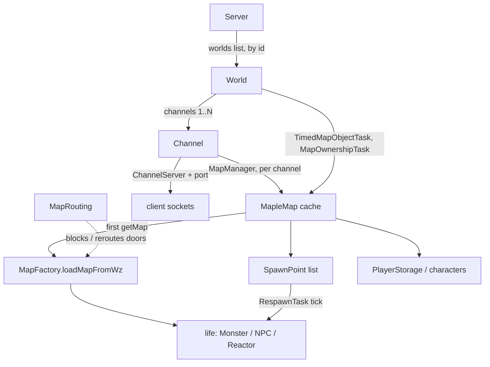

# World and maps

## Purpose

This is the containment hierarchy every live game object hangs off: a running server owns worlds, a world owns
channels, a channel owns a lazily filled cache of `MapleMap` instances, and each map owns its life (mobs, NPCs,
reactors), drops and the characters standing in it. Nothing here decides gameplay; it decides *where* gameplay
happens, which maps exist at all, what spawns on them and when they are thrown away. It also carries the two
SlumsMS-specific corrections to that model: a routing table that refuses doorways the v83 client cannot survive
(`MapRouting`), and a per-map bot cap that keeps bot swarms from piling into one map (`BotMapCap`).

## Entry points

| Entry | What it does | File:line |
|---|---|---|
| `Server.run` → `WorldConfigs.validate` → `initWorld` loop | validates world ids, then constructs one `World` per configured entry | src/main/java/net/server/Server.java:957, :984-986 |
| `Server.initWorld()` | builds `World` + its channels, registers them | src/main/java/net/server/Server.java:452-495 |
| `Server.addChannel(int)` | adds a channel at runtime | src/main/java/net/server/Server.java:382-424 |
| `Channel(int,int,long,int)` | starts a channel's `ChannelServer` and its (empty) `MapManager` | src/main/java/net/server/channel/Channel.java:130-170 |
| `MapManager.getMap(int)` / `getMapOrFallback(int)` | the only way a map instance is obtained | src/main/java/server/maps/MapManager.java:105-131 |
| `MapFactory.loadMapFromWz` | materializes a `MapleMap` from WZ + DB | src/main/java/server/maps/MapFactory.java:151 |
| `RespawnTask.run` | the respawn tick for every non-empty channel | src/main/java/net/server/task/RespawnTask.java:13-26 |
| `MapleMap.addPlayer` / `removePlayer` | character entry/exit, bot counting, minidungeon hooks | src/main/java/server/maps/MapleMap.java:2814, :3192 |
| `Channel.shutdown` / `World.shutdown` | tears maps down in order | src/main/java/net/server/channel/Channel.java:188-215; src/main/java/net/server/world/World.java:2200-2275 |
| `MapRouting.move` / `blocked` | every portal move consults it | src/main/java/server/maps/MapRouting.java:178, :233 |
| `BotMapCap.onBotCountChanged` | re-evaluates the per-map bot cap | src/main/java/soloMapling/ArtificialPlayer/BotMapCap.java:212 |

## How it works

1. **Boot gate, before anything binds.** `Server.run` calls `WorldConfigs.validate(YamlConfig.config.worlds,
   GameConstants.WORLD_NAMES.length)` (src/main/java/net/server/Server.java:957). It throws `IllegalStateException`
   for an empty list, an empty entry, `id < -1`, `id >= WORLD_NAMES.length` or a duplicate id, naming the 1-based
   entry (src/main/java/config/WorldConfigs.java:55-81). Nothing is bound or written before this point.
2. **World count.** `worldCount = Math.min(YamlConfig.config.worlds.size(), YamlConfig.config.server.WORLDS)`
   (src/main/java/net/server/Server.java:978); if `WORLDS` exceeds the configured entries a warning is logged
   (:979-982) and the loop starts `worldCount` worlds (:984-986).
3. **`initWorld`.** `slot = worlds.size()` guards `slot >= WLDLIST_SIZE` and `slot >= config.worlds.size()`
   (src/main/java/net/server/Server.java:455-462). The id comes from `WorldConfigs.idOf(slot, wc)` — `wc.id` when it
   is `>= 0`, else the slot (src/main/java/config/WorldConfigs.java:23) — so a `config.yaml` that lists a single
   `id: 1` boots Bera and never world 0. `new World(id, flag, event_message, exp, drop, bossdrop, meso, quest,
   travel, fishing)` then `new Channel(id, j, bootTime, slot)` for `j = 1..wc.channels`
   (src/main/java/net/server/Server.java:470-482), then `registerWorld` (src/main/java/net/server/Server.java:501-517) which refuses a slot
   out of order or an id already in use, and `setServerMessage(wc.server_message)`.
4. **World construction registers the world's timers, not its maps.** The `World` ctor stores rates, seeds
   `runningPartyId` to `1000000001` and `runningMessengerId` to 1 (src/main/java/net/server/world/World.java:180-181),
   then registers against `TimerManager`: `TimedMapObjectTask` every minute (src/main/java/net/server/world/World.java:207), `MapOwnershipTask`
   every 20 s (src/main/java/net/server/world/World.java:210), `CharacterHpDecreaseTask` at `MAP_DAMAGE_OVERTIME_INTERVAL`
   (src/main/java/net/server/world/World.java:215), plus pets, autosave, merchants, weddings, fishing, party search, timeouts. No map is loaded at
   boot — the cache starts empty.
5. **Channel construction.** `mapManager = new MapManager(null, world, channel)` (src/main/java/net/server/channel/Channel.java:135),
   `port = channelPort(BASE_PORT, portSlot, channel)` with `basePort + (channel - 1) + (portSlot * 100)`
   (src/main/java/net/server/channel/Channel.java:66-68, :136), `ip = HOST + ":" + port`, then `initServer(port, world, channel)`
   (src/main/java/net/server/channel/Channel.java:144). Event scripts are only loaded when `Server.getInstance().isOnline()`, i.e. on a runtime
   `addChannel`, not during boot (src/main/java/net/server/channel/Channel.java:146-153, comment "postpone event loading to improve boot time").
6. **Map load is demand-driven and never substitutes a bad map.** `MapManager.getMap` read-locks the cache and on a
   miss calls the `synchronized` `loadMapFromWz` (src/main/java/server/maps/MapManager.java:105-113, :65). That method
   first asks `MapRouting.blocked(mapid)` and returns **null**, logging
   `"map routing: map {} is blocked ({})"`, instead of returning some other map
   (src/main/java/server/maps/MapManager.java:72-76); otherwise it calls `MapFactory.loadMapFromWz(mapid, world, channel, event)`
   (src/main/java/server/maps/MapManager.java:90) and caches only a non-null result — a null image is never cached, or every later `getMap`
   would NPE (src/main/java/server/maps/MapManager.java:92-97). `getMapOrFallback` is the one explicit exception: it substitutes
   `MapRouting.fallback(mapid)` and warns (src/main/java/server/maps/MapManager.java:123-131).
7. **`MapFactory.loadMapFromWz` builds one map.** Resolve `Map/Map<area>/<9-digit>.img` (src/main/java/server/maps/MapFactory.java:154-161),
   follow a `link` node one hop (a second miss logs `"map {} links to {} which has no image, returning no map"`,
   src/main/java/server/maps/MapFactory.java:166-171), derive `monsterRate` from `mobRate`, `new MapleMap(...)` (src/main/java/server/maps/MapFactory.java:178), then
   portals via `PortalFactory` (src/main/java/server/maps/MapFactory.java:194), PlayerNPCs from `SELECT * FROM playernpcs WHERE map = ? AND
   world = ?` (src/main/java/server/maps/MapFactory.java:288-301), life from WZ (src/main/java/server/maps/MapFactory.java:309) and from `SELECT * FROM plife WHERE map =
   ? and world = ?` (src/main/java/server/maps/MapFactory.java:310), reactors (src/main/java/server/maps/MapFactory.java:346), `setMobCapacity(fixedMobCapacity, default
   500)` (src/main/java/server/maps/MapFactory.java:364) and the map drop range cache (src/main/java/server/maps/MapFactory.java:386).
8. **Life becomes spawn points.** `loadLifeRaw` (src/main/java/server/maps/MapFactory.java:134-149): a mob with
   `mobTime == -1` is spawned once immediately and never respawns; everything else goes to `map.addMonsterSpawn(...)`
   and *all* points also to `map.addAllMonsterSpawn(...)` so a reset can rebuild the map. `SpawnPoint.getMonster`
   (src/main/java/server/life/SpawnPoint.java:81-110) builds a fresh `Monster` from the cached stats, sets position,
   team, foothold and spawn counters, and registers a `MonsterListener` whose `monsterKilled` sets
   `nextPossibleSpawn = now + (mobTime > 0 ? SECONDS.toMillis(mobTime) : aniTime)` (:90-101); `mobTime == 0` instead
   uses `mobInterval` (default 5000 ms, :41 and :106-108).
9. **The respawn tick.** `RespawnTask` runs every `RESPAWN_INTERVAL`
   (src/main/java/net/server/Server.java:1097). It walks `Server.getAllChannels()` and skips any channel whose
   `PlayerStorage` is null or empty — an empty channel costs nothing (src/main/java/net/server/task/RespawnTask.java:14-26)
   — otherwise `mapManager.updateMaps()`, which calls `map.respawn()` and `map.mobMpRecovery()` per cached map
   (src/main/java/server/maps/MapManager.java:159-163).
10. **What `respawn()` spawns.** It returns early when `allowSummons` is false or the map has no characters
    (src/main/java/server/maps/MapleMap.java:4440-4456), computes
    `numShouldSpawn = (spawnPoints * multiplier) - alive` when `USE_ENABLE_FULL_RESPAWN`, else
    `Math.ceil(getCurrentSpawnRate(numPlayers) * spawnPoints) - alive` (:4426-4439), where
    `getCurrentSpawnRate = (0.70 + (0.05 * Math.min(6, numPlayers))) * spawnRateMultiplier` (:4413-4417). It then
    copies and shuffles the spawn list and calls the static `spawnFrom(list, max, consumer)` (:4440-4462, :4469-4481),
    which only asks points whose `shouldSpawn()` is true (src/main/java/server/life/SpawnPoint.java:70-75) and stops
    at `max`. `spawnMonster` additionally refuses when the map's mob capacity is exactly reached (:2344).
11. **Other per-map ticks.** `TimedMapObjectTask` calls `World.runTimedMapObjectSchedule()`, which collects expired
    entries under `timedMapObjectLock`, removes them, then runs them *outside* the lock
    (src/main/java/net/server/world/World.java:1761-1799). `MapOwnershipTask` calls
    `Channel.runCheckOwnedMapsSchedule()`, which iterates its weak-set of owned maps and calls
    `map.checkMapOwnerActivity()` (src/main/java/net/server/channel/Channel.java:1115-1127). Each occupied map also
    runs its own `TimerManager` tasks started in `addPlayer`: the item monitor at `ITEM_MONITOR_TIME`, drop expiry at
    `ITEM_EXPIRE_CHECK` and, when `USE_SPAWN_LOOT_ON_ANIMATION`, a 200 ms loot spawner
    (src/main/java/server/maps/MapleMap.java:949-1004).
12. **Entry placement.** `addPlayer` records a per-entry stamp, increments the bot counter for bots, notifies
    `BotMapCap` (src/main/java/server/maps/MapleMap.java:2834-2850). `sendObjectPlacement` then splits the map into
    what the entrant can see and what is deferred: bots (`deferrableCharacter`) and `ITEM` objects outside
    `VIEW_RANGE_SQ = 722_500` go into a `Deferred` list and are sent nearest-first, one chunk per `STEP_MS = 100`,
    at most `MAX_STEPS = 15` chunks (src/main/java/server/maps/MapleMap.java:3503-3520, :3567-3590;
    src/main/java/server/maps/MapEntryPlacement.java:39-45). Mobs never trickle (src/main/java/server/maps/MapEntryPlacement.java:87-89).
13. **Unload.** `Channel.shutdown` runs every step through `shutdownStep(what, Runnable)` so one failure cannot abort
    the rest: merchants, away players, players, event scripts, then `mapManager.dispose()` and `mapManager = null`
    (src/main/java/net/server/channel/Channel.java:198-215). `MapManager.dispose` disposes each cached map and drops
    the event reference (src/main/java/server/maps/MapManager.java:166-172); `MapleMap.dispose` disposes every
    monster, clears objects, nulls footholds/portals/effect and cancels the map's own timers
    (src/main/java/server/maps/MapleMap.java:5292-5330). A `World.shutdown` shuts its channels first and then
    cancels its own schedules (src/main/java/net/server/world/World.java:2200-2275). Event instances get their own
    `MapManager` (src/main/java/scripting/event/EventInstanceManager.java:147) which is disposed a minute after the
    event ends (src/main/java/scripting/event/EventInstanceManager.java:837-847).

## Data

| Object | Holds | File:line |
|---|---|---|
| `Server` | `worlds` (start order), `worldsById`, `channels` (world id → channel id → ip) | src/main/java/net/server/Server.java:120-122 |
| `World` | id, flag, event message, 7 rates, `List<Channel>`, `PlayerStorage`, party/guild/messenger stores, 13 `ScheduledFuture`s | src/main/java/net/server/world/World.java:82-90, :130-165 |
| `Channel` | world id, channel id, port, `MapManager`, `PlayerStorage`, `ChannelServer`, `dungeons`, `ownedMaps` (weak set), dojo arrays | src/main/java/net/server/channel/Channel.java:73-97 |
| `MapManager` | `Map<Integer,MapleMap> maps` (`HashMap`) + fair RW locks; optional `EventInstanceManager` | src/main/java/server/maps/MapManager.java:35-42 |
| `MapleMap` | `mapobjects`, `monsterSpawn`, `allMonsterSpawn`, `spawnedMonstersOnMap`, `characters`, `botCount`, `entryStamps`, `portals`, `footholds`, `droppedItems`, `mapOwner` | src/main/java/server/maps/MapleMap.java:71-139 |
| `SpawnPoint` | monster id, position, foothold, f/team, `mobTime`, `mobInterval`, `nextPossibleSpawn`, live count, `denySpawn` | src/main/java/server/life/SpawnPoint.java:34-44 |
| `MapRouting` | `BLOCKED`, `KIND`, `BY_PORTAL` (key = `(from<<32)` OR-ed with target), `ANY_PORTAL`, `FROM_ANYWHERE`, `FALLBACK` | src/main/java/server/maps/MapRouting.java:66-80 |

Persistent inputs used at map build time: table `plife` (map + world scoped life overrides, src/main/java/server/maps/MapFactory.java:107),
table `playernpcs` (src/main/java/server/maps/MapFactory.java:289), and the classpath table `/soloMapling/map-routing.tsv`
(src/main/java/server/maps/MapRouting.java:47) — 119 lines, 63 route rows and 49 blocked rows measured in this
tree; the generator (and the third "mob without an image" class of 229 maps) is described in docs/ops/map-routing.md.

## Switches

| Switch | Default | Where | Effect |
|---|---|---|---|
| `-Dmapleroot.channel-base-port` | `7585` | src/main/java/net/server/channel/Channel.java:64 | first block of channel ports; slot N adds `100*N` |
| `-Dslumsms.channelLoad.botWeight` | `0.25` | src/main/java/net/server/channel/Channel.java:299-300 | a bot counts as 25 % of a player in the channel load bar |
| `-Dslums.maps.routing` | `true` | src/main/java/server/maps/MapRouting.java:50 | master off switch: `false` makes every `route`/`move` return null |
| `-Dslums.maps.routing.table` | `/soloMapling/map-routing.tsv` | src/main/java/server/maps/MapRouting.java:49 | overrides the table path (file instead of classpath) |
| `-Dslums.mobStatOverrides` | `true` | src/main/java/server/life/MobStatOverrides.java:62 | loads `/soloMapling/mob-stat-overrides.tsv` (ticket 81 HP/EXP) |
| `WORLDS` | `1` (example) | src/main/java/config/ServerConfig.java:21; config.example.yaml:57 | upper bound on started worlds |
| `WLDLIST_SIZE` | `21` | src/main/java/config/ServerConfig.java:22; config.example.yaml:58 | hard bound in `initWorld` |
| `CHANNEL_SIZE` | `20` | src/main/java/config/ServerConfig.java:23; config.example.yaml:59 | `addChannel` refuses at this count (-2) |
| `CHANNEL_LOAD` | `100` | src/main/java/config/ServerConfig.java:24; config.example.yaml:60 | load-bar budget used with the bot weight |
| `RESPAWN_INTERVAL` | `10000` ms | src/main/java/config/ServerConfig.java:27; config.example.yaml:62 | respawn tick period |
| `MAP_ENTRY_TRICKLE` | `true` | src/main/java/config/ServerConfig.java:137; config.example.yaml:118 | enables deferred entry placement |
| `BOT_MAP_CAP` | `50` | src/main/java/config/ServerConfig.java:197; config.example.yaml:142 | bots allowed per (channel, map) |
| `BOT_MAP_CAP_OVERRIDES` | `""` | src/main/java/config/ServerConfig.java:199; config.example.yaml:143 | `mapId:cap,...`; `0` = uncapped |
| `BOT_TOWN_MAP_MAX` | `200` | src/main/java/config/ServerConfig.java:183; config.example.yaml:138 | raised cap for a town map while town pull is on |
| `WORLD_EVENT_MAP_MAX` | `200` | src/main/java/config/ServerConfig.java:203; config.example.yaml:144 | raised cap during a world invasion |
| `USE_ENABLE_FULL_RESPAWN` | `false` | src/main/java/config/ServerConfig.java:351; config.example.yaml:258 | spawn-point-count spawn instead of the player-scaled rate |
| `ITEM_EXPIRE_TIME` / `ITEM_MONITOR_TIME` / `ITEM_EXPIRE_CHECK` / `ITEM_LIMIT_ON_MAP` | `180000` / `300000` / `10000` / `200` | src/main/java/config/ServerConfig.java:421, :423, :427, :428; config.example.yaml:324, :328, :334, :336 | drop lifetime, map item-monitor period, expiry sweep, per-map drop ceiling |
| `MAP_DAMAGE_OVERTIME_INTERVAL` / `_COUNT` | `2500` / `2` | src/main/java/config/ServerConfig.java:430-431; config.example.yaml:340, :342 | map HP decay period and ticks per hit |
| `worlds[].id` / `channels` / rates | `-1` (slot) / `1` / `1` | src/main/java/config/WorldConfig.java:3-17 | world identity, channel count, exp/drop/meso/quest/travel/fishing multipliers |

Live (docs/release/1.6.4.conf) sets `CHANNELS=5` (:277), `CHANNEL_LOAD=125` (:278) and `MIN_CLIENT_BUILD=10740`
(:294), and its `FORBID_LOG` includes `"Starting world 0"` (:296-297) — live runs world 1 only. The same file sets no
`RESPAWN_INTERVAL`, `BOT_MAP_CAP` or `MAP_ENTRY_TRICKLE` line, so live's values for those come from live's
`config.yaml`, which is not in this repository: **live's respawn period and bot cap are unknown here**. TEST's
`start-test.sh` is on another host and is not reachable, so TEST's settings are unknown too.

## Invariants

- A world id comes from config, not from position; duplicates or out-of-range ids stop the boot
  (src/main/java/config/WorldConfigs.java:55-81, called at src/main/java/net/server/Server.java:957).
- Worlds register in slot order and an id can never run twice (src/main/java/net/server/Server.java:501-521;
  src/test/java/net/server/ServerWorldRegistryTest.java:49).
- Channel ports follow the world's *slot*, not its id, so a lone Bera keeps 7585-7592
  (src/main/java/net/server/channel/Channel.java:66-68, :130-136).
- `MapManager.getMap` never substitutes: a blocked map is `null`; only `getMapOrFallback` substitutes
  (src/main/java/server/maps/MapManager.java:72-76, :123-131).
- A map that failed to load is never cached, so the next `getMap` retries instead of NPE-ing
  (src/main/java/server/maps/MapManager.java:92-97).
- One `MapleMap` instance per (channel, mapid) within a `MapManager`; event instances get their own manager
  (src/main/java/scripting/event/EventInstanceManager.java:147).
- Respawning only happens on maps that have characters and only while `allowSummons` is true
  (src/main/java/server/maps/MapleMap.java:4440-4456); `RespawnTask` skips channels with no players at all
  (src/main/java/net/server/task/RespawnTask.java:17-22).
- A spawn point with `denySpawn`, `mobTime < 0`, or a live mob never spawns from the tick
  (src/main/java/server/life/SpawnPoint.java:70-75).
- The bot cap only refuses additions; it never moves a bot that is already there
  (src/main/java/soloMapling/ArtificialPlayer/BotMapCap.java:34-37).
- Map ownership lasts 60 s of idleness before it is released (src/main/java/server/maps/MapleMap.java:5014-5018).

## Origin

| File | Origin | Evidence |
|---|---|---|
| src/main/java/server/maps/MapleMap.java | base, modified | oldest 03d13cb21 2026-10-18; present upstream, differs |
| src/main/java/server/maps/MapFactory.java | base, modified | same |
| src/main/java/server/maps/MapManager.java | base, modified | same; blocked-map guard and null-not-cached are ours |
| src/main/java/net/server/world/World.java | base, modified | same; `beginShutdown` cites 1.5.2 nutnnut/Cosmic e61767a42 (:2186-2191) |
| src/main/java/net/server/channel/Channel.java | base, modified | same; port-slot ctor and `shutdownStep` are ours |
| src/main/java/server/life/SpawnPoint.java | base, modified | same; only the `MonsterListener` heal signature differs from upstream |
| src/main/java/server/life/LifeFactory.java | base, modified | same; hard-code HP table, ticket 81 override, quiet failed-load cache |
| src/main/java/server/maps/MapItem.java, ReactorFactory.java, src/main/java/server/life/Monster.java | base, modified | present upstream, differ |
| src/main/java/server/maps/MiniDungeon.java, src/main/java/config/WorldConfig.java | base, modified | present upstream, differ |
| src/main/java/server/events/Events.java, server/events/RescueGaga.java | base, unmodified | present upstream, identical |
| src/main/java/server/loot/LootManager.java, LootInventory.java | base, unmodified | identical |
| src/main/java/server/maps/Reactor.java, MapMonitor.java | base, unmodified | identical |
| src/main/java/net/server/task/MapOwnershipTask.java | base, unmodified | identical |
| src/main/java/server/maps/MapRouting.java | custom | oldest 6aadd9c81 2026-10-31; absent from /root/workspace/cosmicms |
| src/main/java/server/maps/MapEntryPlacement.java | custom | absent upstream; cited as 1.4.2 perf work in its javadoc |
| src/main/java/server/life/MobStatOverrides.java | custom | oldest 0e8cec105 2026-10-28; absent upstream; ticket 81 |
| src/main/java/config/WorldConfigs.java | custom | absent upstream; ticket 41 |
| src/main/java/soloMapling/ArtificialPlayer/BotMapCap.java | custom | oldest 3fde80134 2026-10-23; absent upstream |
| src/main/java/net/server/task/RespawnTask.java, TimedMapObjectTask.java | base | oldest 03d13cb21; Cosmic-era Ronan/Resinate classes |

tools/cosmicdiff/classifications.json:211-222 records two deliberate MapleMap deviations: the missing
`MapleMap.broadcastZakumVictory` ("MapleRoot commented out every boss victory world message … Owner decision
2026-10-21: KEEP the repack's way") and the missing visibility refresh in `moveBot` ("'cause a lot of MapItem
errors").

## Tests and QA

| Layer | Coverage | File |
|---|---|---|
| World id rules | Bera alone is world 1, no world 0, home world, duplicate id refused | src/test/java/config/WorldConfigsTest.java:33; src/test/java/net/server/ServerWorldRegistryTest.java:30, :48, :60, :67 |
| Channel ports | first world gets base ports whatever its id; later worlds take the next hundred | src/test/java/net/server/channel/ChannelPortTest.java:9, :15 |
| Respawn maths | denied points, requested count, multiplier applied once | src/test/java/server/maps/MapRespawnLimitsTest.java:27, :37, :43 |
| Entry trickle | chunking, nearest-first, stamps, listener | src/test/java/server/maps/MapEntryPlacementTest.java:39, 65, 79, 92, 106, 130, 149, 170 |
| Routing table | table in jar, Gollux blocked, Rampart loads again, no route into a blocked map, every blocked map has a fallback, every destination really loads | src/test/java/server/maps/MapRoutingTableTest.java; src/test/java/server/maps/MapRoutingWzTest.java:106, :127, :158 |
| Routing at runtime | blocked `getMap` returns null, only fallback substitutes, login paths, warp rows | src/test/java/server/maps/MapRoutingWzTest.java:69, :75; src/test/java/net/server/CharacterLoginMapRoutingTest.java; src/test/java/net/server/MapRoutingEntryPathsTest.java; src/test/java/server/maps/MapRoutingWarpTest.java |
| Reactors | unnamed item event tolerated, no image → inert | src/test/java/server/maps/ReactorLoadTest.java:57, 68, 75, 85, 107 |
| Bot counting | bots count in and out, players do not | src/test/java/server/maps/MapBotCountTest.java:16 |
| Drops / ownership on a map | global drops, item owner packet | src/test/java/server/maps/MapleMapGlobalDropTest.java; MapItemOwnerClientTest.java |
| Portals / areas | quiet portal triggers, Crack in Time, Lower Grandis, Orbis, AreaGates, Zakum arms | src/test/java/server/maps/CrackInTimePortalsTest.java, LowerGrandisPortalsWzTest.java, PortalTriggerQuietTest.java, AreaGatesTest.java, ZakumArmShieldTest.java |
| Life factory | failed-load cache, missing exp, override file, cache concurrency | src/test/java/server/life/LifeFactoryFailedLoadCacheTest.java, LifeFactoryMissingExpTest.java, MobStatOverridesTest.java, MobCacheConcurrencyTest.java |
| Shutdown | GM broadcast to a channel whose player storage is already null, autosave during shutdown | src/test/java/net/server/channel/ChannelBroadcastAfterShutdownTest.java:19; src/test/java/net/server/task/AutosaveDuringShutdownTest.java |
| Auto-QA | `t-mp-1` (2 min, half: walk Fountain Square, a Gollux leg, Rose Garden east00 in a real client), `t-nv-2` bot world graph, `t-ev-2` invasion deaths | src/main/java/soloMapling/autoqa/AutoQaCatalog.java:1552-1556, :1540, :1087; probe src/main/java/soloMapling/autoqa/Probes164.java:423 |
| QA scenario | `pe-1` entry timing between Henesys and Henesys Market, `MAP_ENTRY` log lines | src/main/java/soloMapling/qa/QaScenarios.java:859-910 |

Not covered: there is no test that boots two worlds and asserts distinct map caches, none that asserts
`World.shutdown`/`Channel.shutdown` idempotence under concurrent tasks, none for `MapMonitor`'s 5 s idle teardown,
none for `MiniDungeon.close` racing `changeMap`, and none that exercises `MapFactory.loadLifeFromDb` (the `plife`
override path) — it has no test class in this tree.

## Known issues

| Card | One line | Evidence |
|---|---|---|
| b300 (S2) | Map 272000000 "Crack in Time" (Leafre of the Past hub) traps characters; live mitigation moved 6 characters on Nov 4 07:12 UTC | /root/work/STATUS-1.6.4.md:49 |
| b251 (S2) | Client crashes entering Rose Garden Abandoned Garden 211080100; routing stays, "work on this in another patch" | /root/work/STATUS-1.6.4.md:72 |
| ticket 272 | Missing `Map/Obj/mario.img` (211080700, 402000324, 863010240), `starPlanet.img` (814040000, 814041900), linked map 100020500 for 100020549-100020599; 247 map ids still fatal-class | docs/tickets/272-client-map-integrity-and-crashes.md:1-50 |
| b274 (S3) | Will's and Magnus's boss portals never send a portal-enter, so the fight cannot be entered from them | /root/work/STATUS-1.6.4.md:76 |
| b276 (S4) | Bot map-scoped PLAN/ROUTE lines never reach the GM QA feed | /root/work/STATUS-1.6.4.md:78 |
| PQ report | HardLotusBattle maps 67 and 1065 absent from Map.wz; Hard Will/Lucid/Darknell/Verus spawn at 60/120/240 s, beyond the 30 s empty-room grace | /root/work/PQ-UNFINISHED-REPORT.md:104-108 |
| owner decision 14 | Reduced Chaos Horntail must not ship: `isHorntailDefeated()` needs all eight normal corpses and the extra ids are absent | /root/work/OWNER-DECISIONS.md:119 |
| s-maproute | 49 blocked maps (38 missing image, 11 client crash) rerouted by table; a third class, 229 maps whose mob has no image, is refused by the generator | docs/ops/map-routing.md; src/main/resources/soloMapling/map-routing.tsv |
| NEW-FINDING | src/main/java/server/maps/MapFactory.java:391-393 uses `LifeFactory.getLife(id, type)` without a null check and immediately calls `myLife.setCy(cy)`; an unknown life type (LifeFactory logs "Unknown Life type") or a mob with no Mob.wz image NPEs the whole map load instead of skipping the life — the same failure class docs/ops/map-routing.md has to route around. | src/main/java/server/maps/MapFactory.java:391-403; src/main/java/server/life/LifeFactory.java:47-57 |
| NEW-FINDING | src/main/java/net/server/channel/Channel.java:207 nulls `mapManager` during shutdown while `getMapFactory()` at :265 returns it with no null guard, so any task or script that runs between "dispose its maps" and "stop its network service" dereferences null instead of failing with a clear "channel is gone". | src/main/java/net/server/channel/Channel.java:205-210, :265 |
| NEW-FINDING | src/main/java/server/maps/MapleMap.java:3193 starts `removePlayer` with `chr.getClient().getChannelServer()`; a character whose client is already detached (logout/DC path) NPEs inside map removal. | src/main/java/server/maps/MapleMap.java:3192-3194 |
| NEW-FINDING | `respawn()` sizes its rate from `characters.size()`, which includes bots, so a bot-swarmed map runs at the 6-player maximum rate (formula caps at 6 players) — probably intended, but nothing states it and `BotMapCap` is the only brake. | src/main/java/server/maps/MapleMap.java:4413-4417, :4446-4450 |

## State

- **World/channel topology: working.** World ids, slot-ordered registration, channel ports and Bera-alone are
  covered by unit tests (`WorldConfigsTest`, `ServerWorldRegistryTest`, `ChannelPortTest`) and the
  boot path validates ids before binding (src/main/java/net/server/Server.java:957).
- **Map lifetime and respawn: working.** Cache, null-not-cached, `updateMaps`, `dispose` are all exercised by
  `MapRespawnLimitsTest`, `ReactorLoadTest` and `ChannelBroadcastAfterShutdownTest`; the respawn formula is a single
  expression with a dedicated test.
- **Map data: partial.** The machinery is sound but the v83 data set is not: 49 maps are blocked and routed around,
  247 map ids still carry fatal-class findings, and b300/b251 are open live defects
  (docs/tickets/272-client-map-integrity-and-crashes.md, /root/work/STATUS-1.6.4.md:49, :72).
- **Bot map cap: working** as specified (add-only, town/event raises); no test asserts the town raise or the
  override parsing beyond `BotMapCap`'s own helpers.
- **Entry trickle: working** (`MapEntryPlacementTest` plus `pe-1` QA scenario), but no measurement of the real client
  path exists in-repo beyond the QA meter.
- **Minidungeon/MapMonitor lifecycles: unknown.** No tests; both depend on `TimerManager` timing and on
  `changeMap` lock ordering, and `MiniDungeon.close` carries a deadlock comment rather than a test
  (src/main/java/server/maps/MiniDungeon.java:96-112).

## Open questions

- Live's actual `RESPAWN_INTERVAL`, `BOT_MAP_CAP`, `MAP_ENTRY_TRICKLE` and `worlds[].id/channels`: live's
  `config.yaml` is not in this repository and was not opened. docs/release/1.6.4.conf only fixes `CHANNELS=5`,
  `CHANNEL_LOAD=125` and the world-0 ban.
- TEST's settings at all: `start-test.sh` lives on another host and is unreachable from this worktree.
- Whether `MapFactory.loadMapFromWz` is meant to catch a null life and skip it (so a map with one broken mob still
  loads) or to fail the whole map: the code does neither by design — it NPEs (see NEW-FINDING above).
- Why `MapMonitor` uses a fixed 5 s idle check while `MapleMap`'s own item monitor uses `ITEM_MONITOR_TIME`: no
  comment explains the split.
- Whether the 229 "mob without an image" maps are meant to be enumerated somewhere for QA (`t-nv-2` only covers the
  bot graph), or if refusing them at generation time is the whole plan.
- The 60 s ownership idle window (`src/main/java/server/maps/MapleMap.java:5016`) is a literal; no config key exists for it and no ticket asks
  for one.
