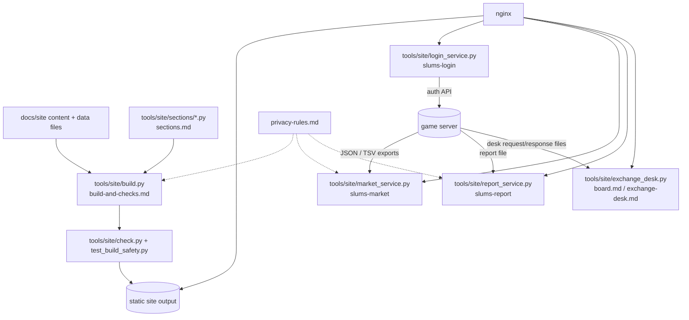

# Website system

The player-facing static site and the four small Python services behind it (login, market, reports, exchange desk).

## Purpose

Publish what players need outside the game — news, downloads, leaderboards, market prices, the report form and the
exchange desk — from a static build plus a few narrow HTTP services, without ever handing the game server's database
to the web tier. Everything the site shows is either committed content or a file the game server wrote.

Repo: `/root/work/SlumsMS-site-164-street` (branch `site-164-street`). No Java in this branch; the server-side
counterparts live in `/root/work/SlumsMS-164-archreview/src/main/java/soloMapling/{site,dashboard}/` and
`server/reports/`.

## Parts

## Main flows

1. **Build.** `build.py` renders the sections into the static output; `check.py` re-reads the output and refuses if a
   rule (escaping, no local paths, no private data) is broken; the build fails rather than ships (`build-and-checks.md`).
2. **Deploy.** `deploy-build-164.sh` copies the tool, data and icon cache to the build folder on the site host and
   records `DEPLOYED_COMMIT`; it neither builds, publishes nor reloads anything (`deploy.md`).
3. **Login.** Sign-up and login go through `login_service.py` into the game server's auth API; the account then exists
   for both the launcher and the game (`login-service.md`).
4. **Market.** Prices come from the server's market/economy exports; the service serves a cached view
   (`market-service.md`).
5. **Reports.** The server writes a reports file; the site reads and presents it with privacy scrubbing applied at
   both ends (`report-service.md`, `privacy-rules.md`).
6. **Exchange desk.** A trade request is a file: the site writes it, the server picks it up and writes the response
   (`exchange-desk.md`).
7. **Board.** Structured WTB/WTS posts under moderation and identity rules; there are no replies (`board.md`).

## Subsystems

| Subsystem | File |
|---|---|
| Build, checks and preview | `build-and-checks.md` |
| Section modules | `sections.md` |
| Login and accounts | `login-service.md` |
| Market pages | `market-service.md` |
| Report pages | `report-service.md` |
| Exchange desk contract | `exchange-desk.md` |
| Board | `board.md` |
| Deploy units and nginx | `deploy.md` |
| Privacy rules | `privacy-rules.md` |

## Switches

Per-service environment and unit files (`slums-login`, `slums-market`, `slums-report`, `slums-site-market`,
`slums-site-world`), named by path; the game side reads `-Dslums.auth.port` and `-Dslums.exchange.desk` from
`docs/release/1.6.4.conf:271`. Secret files are named by path only in these docs.

## Invariants

- The web tier never holds a game DB connection; it reads exported files and the auth API.
- No emails, IPs, passwords or account ids on public pages — enforced in the build checks and exporters, see
  `privacy-rules.md` for which rules are code and which are only prose.
- A build that fails a check is not deployable (`build-and-checks.md`).
