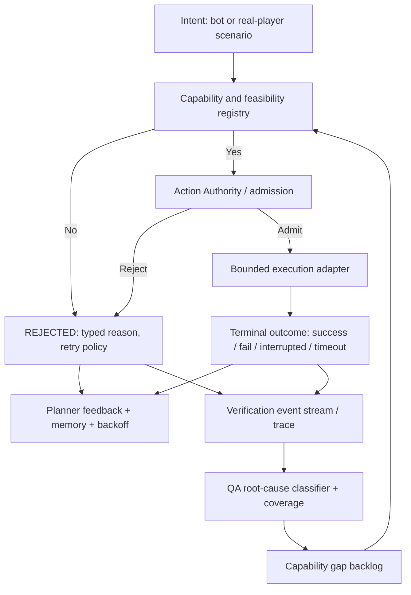
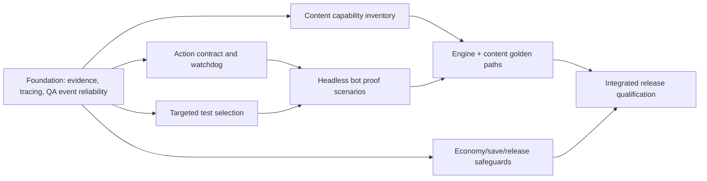

# SLUMSMS 1.7.0
## Systems-First Stabilization & Autonomous World Reliability Proposal

**Decision proposal | 5 November 2026 | For Claude / coordination, server, bot, QA, client, launcher, website, and operations agents**  
**Status:** Adopted by the owner as the 1.7.0 plan (Nov 5 2026), with Claude's corrections below. 1.6.5 is folded into 1.7.0. Each live change still needs the owner's go.  
**Baseline:** `joshhmann/SlumsMS` `release-1.6.4` (audit began near `a26fdb6c`); launcher `joshhmann/slumsms-launcher`. Confirm branch SHA and current behavior at kickoff. Website source IS on GitHub: `tools/site/` on the `site-*` branches of `joshhmann/SlumsMS` (newest: `origin/site-164-exitems`, `origin/site-161-framework`). The native client source is not on GitHub; it lives on the build box.

> **Decision requested:** Designate **1.7.0 as a systems-first reliability release**. Freeze broad feature expansion; close critical correctness gaps; establish a bounded, observable bot execution lifecycle; add change-based selection to the existing QA tiers; and build a capability-driven content repair pipeline. Release only when explicit gates are satisfied.

---

## 00 / Corrections and status (Claude, 5 Nov 2026, checked on `release-1.6.4` @ `26f46a197`)

Read this first; the body below has been edited to match.

**Owner decisions (Nov 5):** adopt this as the 1.7.0 plan. **1.6.5 is folded into 1.7.0**; its carry-over list
(`docs/release/1.6.4-playbook.md` section C: Holiday PQ, Elnath PQ stages, Von Leon / Cygnus / Hard Lotus / Balrog Easy,
Chaos Horntail, b287, b291, b274, b280, open boss/PQ decisions) is triaged under the 1.7.0 freeze: fixes stay in,
new content/features go to the 1.8.x backlog unless they block a golden path.

**Code claims, re-checked by Claude:**

| Claim | Verdict | Evidence |
|---|---|---|
| Buyback flag committed before items are granted | **CONFIRMED** | `TransactionService.java:108-123`: `updateTransactionBuybackStatus(..., true)` first; an exception in the add loop returns failure with the flag already set and mesos possibly not taken; no retry possible |
| `!saveall` reports success regardless | **CONFIRMED** (GM-only, low risk) | `SaveAllCommand.java:39-48`: `saveCharToDB()` is void; message is unconditional |
| QA runner loses events in a batch | **CONFIRMED** | `qarunner.py:381-389` advances the cursor over the whole batch; `wait_signal` (`:476-494`) takes the first match; other events in that batch are kept in `self.seen` but only `qa_closed` reads it, so a later wait for them misses. Affects the Windows client runner, not server auto-QA |
| HELP_FRIEND in a mobless map earns abstract EXP | **CONFIRMED**; same bug as HOLES "b240 town EXP" | `TrainingBot.java:1085` `Math.max(1, level)` turns -1 into 1; `:2140` gate `currentMobLevel > 0` passes; `OffscreenSupplies.accrue` returns 1.0 when the rate has no swings |
| `deploy-test` marks the commit before readiness and ignores a boot timeout | **CONFIRMED** | `tools/ops/deploy-test:115` writes `DEPLOYED_COMMIT` before the start at `:117`; the wait loop `:118` ends silently after 90 tries; only boot ERROR lines fail it (`:123`) |
| Release receipt guard strengthened | **CONFIRMED** | `release-live.sh:27` requires `**Result: PASS**` (fixed Nov 5, b323) |
| Bot selected/accepted counts are distinct | **CONFIRMED** | `LifeRuntime.java`; also reported live as `decisions` / `accepted` in `tools/ops/test-status` |

**Factual corrections:**

1. **QA does not take six hours.** Measured on TEST, Nov 5: the full release auto-QA was **197 checks in 2 h 22 min**
   (10:08-12:31 UTC); a targeted rerun of 16 checks took **20 min**, a single check **2.5 min**. Targeted runs already
   exist (`tools/ops/autoqa-run t-xc-5,t-mx-5,...`), and every run records `wallSeconds`/`checkSeconds` per run in
   `data/autoqa/latest.json` (`AutoQaReport.java:292`). The "six hours" was the social soak window (a 6 h TEST uptime
   wait before reading social numbers), not QA. So W0 is smaller: keep the existing runner, add file->check selection,
   per-check timing in the report, and fix the client-runner event loss.
2. **Existing tiers map onto L0-L4 already**: L1 = `mvn test` (~12,140 JUnit tests, includes FakeQaWorld scenario
   staging tests); L2/L3 = server auto-QA probes (`soloMapling/autoqa`, headless, on the TEST JVM with MySQL);
   L4 = the Windows client runner (`tools/qa-runner`, Windows test VM) plus the release rehearsal
   (`tools/release/rehearse-host.sh` -> `REHEARSAL.md`). Build on these; don't add a parallel harness.
3. **Bot action tracing partly exists**: `LifeRuntime` decision/acceptance counters, `!botwhy` (`BotWhyCommand.java`),
   `BotDeaths`, health checks (foothold/stuck/clumps) in `test-status`. The ActionAuthority RFC must extend these
   (one implementation for alts and bots, per house rule), not add a second tracker.
4. **Release identity partly exists**: `Server/DEPLOYED_COMMIT`, `REHEARSAL.md` receipt, client `MIN_CLIENT_BUILD`
   gate (10740 for 1.6.4), per-release `docs/release/<ver>.conf`. W4's manifest should unify these rather than start
   fresh. **Revised (round 2):** only the launcher's *self-update* is signed (Tauri/minisign, pubkey in
   `launcher: tauri/app/tauri.conf.json:41`). The *game-content* manifest is integrity-checked only (`sha256` per file,
   layer and pack, `tauri/core/src/manifest.rs:154-339`); nothing authenticates its publisher beyond HTTPS to the patch
   host, and nothing stops an older valid manifest being served. Release authenticity and rollback protection for
   game content stay **open** in W4.
5. **Process weight**: keep the substance (typed reasons, terminal outcomes, golden paths, safety fixes, gates G0-G5),
   but keep tickets on the existing release book and status words (triaged / ontest / check / fixed) rather than a
   9-state lifecycle. The team is one owner plus agents.

**House rules that override anything below:** live changes need the owner's explicit go for that change; TEST work and
merges don't; never read or print secrets (name by path); no `git stash`; alts and bots share one implementation;
player-facing text never names the original game or its publishers.

**Round 2 (Codex review of these corrections, Nov 5, all ten accepted):** ActionAuthority ownership and exclusivity
rules (3.1); shared execution with separate bot/alt policies (3.1); three kinds of memory plus reassessment when a
capability is repaired (3.3); stage-specific QA targets instead of a 30-60 min certification gate (04); manifest
authenticity kept open (00, item 4; 06); existing four ticket statuses with evidence fields (07); bot KPIs with honest
denominators (08); new workstream W6 Gameplay Capability Recovery (05, 07); a vertical slice before broad build-out (09).

---

## 01 / Executive summary

SlumsMS is no longer just a MapleStory v83 server. Its Java/Netty world, thousands of headless playerbots, patched client, Tauri launcher, website services, release tools, and game-content pipeline form one interconnected product. Today's difficulty is **not primarily a lack of more AI intelligence**. The bot planners already select activities, but the execution side can reject or fail them without reliable structured outcomes or systematic replanning. Meanwhile, missing engine mechanics and broken or incompatible content make valid choices impossible to perform. A full release QA run takes about **2 h 22 min** (197 checks, measured Nov 5), targeted reruns minutes, but the client runner can lose events and there is no file-to-check selection.

**Thesis:** Prioritize *ability to act* over *ability to choose*. Build authoritative capability checks and action-result semantics, then use the same semantics for fast, deterministic headless QA and content coverage. Stop conflating source implementation, passing tests, integrated behavior, and live deployment in one “working” label.

### Desired outcomes

1. **Player safety:** No known high-severity path silently loses or duplicates items/currency; saves and deployments don't claim success when the critical operation failed.
2. **Bot agency:** Every chosen action is admitted or rejected with a reason; every admitted action reaches a terminal outcome or a watchdog timeout; repetitive failure changes the next decision.
3. **QA velocity:** Most routine tickets get targeted feedback without waiting on full release QA; expensive client, soak, and recovery checks are reserved for their appropriate stage.
4. **Content truth:** Map, NPC, quest, item, mob, script, and packet dependencies are inventoried with actionable engine-vs-data-vs-client failure categories.
5. **Release confidence:** Compatible artifacts, runtime switches, migration state, and rollback evidence can be traced to one release identity.

### Evidence boundary

**Code-read confirmed in the previous audit:** buyback flag precedes item grants (`TransactionService.java:108-123`); `!saveall` reports success after a void/logging save (`SaveAllCommand.java:39-48`, `Character.java:10321-10328`); QA batches can consume multiple events while `wait_signal` handles one (`qarunner.py:381-389,476-494`); HELP_FRIEND can map mobless level -1 to 1 and pass abstract-EXP gating (`TrainingBot.java:1084-1086,2138-2146`, `OffscreenSupplies.java:84-91`); bot selected/chosen/accepted counts are distinct (`LifeRuntime.java:522-535,781-798`); live release receipt guard had been strengthened to `**Result: PASS**` (`release-live.sh:25-27`). **Not independently proven:** production incidence and severity, native-client compatibility, website session invalidation, live switches, whole-system scalability. Verify current code at kickoff; do not reopen items already marked checked in the existing `HOLES.md` preface without evidence of change.

---

## 02 / Why 1.7.0 should be systems-first

| Present condition | Why incremental feature work compounds it | 1.7.0 response |
|---|---|---|
| Agent chooses an activity but runtime cannot execute it | More activities multiply rejected branches and obscure root causes | Common action authority + terminal outcome protocol |
| Engine capability or game content is incomplete | Quest/bot “AI failures” are actually map/script/packet/data defects | Capability registry + dependency scanner + targeted scenarios |
| Full release QA takes ~2.4 h; no change-based selection | Long test loops encourage skipping or deferring validation | Change-impact selection + isolated test tiers + runtime budgets |
| Code, docs, release conf, and live state diverge | Agents build on a false understanding of what shipped | Evidence ledger + executable contracts + per-environment status |
| Error recovery is inconsistent | One new feature can expose inventory, session, or deployment data loss | Transaction discipline, idempotency, safe deploy and restore gates |

**Release policy:** No general gameplay expansion until the foundations are accepted. Allow only (a) defect fixes, (b) observability and test infrastructure, (c) content repairs necessary for baseline journeys, (d) strictly bounded compatibility work, and (e) owner-approved emergency security/safety patches. Record attractive new systems in a 1.8.x backlog, not in 1.7.0 scope.

---

## 03 / Target architecture: capabilities -> actions -> outcomes -> verification



### 3.1 One action contract, not another competing bot brain

Keep the existing GOAP planner, LifePolicy scoring, LifeRuntime, TrainingBot phase machine, and LLM dialogue. **Do not rewrite them into microservices.** Introduce a narrow authoritative boundary between intent and execution with one source of truth for admission and state transitions.

**Proposed lifecycle:** `PROPOSED -> ADMITTED -> RUNNING -> {SUCCEEDED | FAILED | INTERRUPTED | TIMED_OUT}` or `PROPOSED -> REJECTED`. Every action receives a stable `attemptId`; state changes are monotonic and idempotent; only the executor/admission authority emits authoritative outcomes. A `REJECTED` action is never counted as a successful activity. `SUCCEEDED` requires an observable postcondition, not “method returned true.”

```json
{
  "attemptId": "qa-2154-42",
  "actorId": 1000000421,
  "activity": "HELP_FRIEND",
  "target": {"characterId": 123},
  "state": "REJECTED",
  "reason": "TARGET_MAP_UNREACHABLE",
  "retryable": true,
  "retryAfterMs": 30000,
  "capability": "navigation.route_to_player",
  "traceId": "qa-2154",
  "schemaVersion": 1
}
```

**Typed reasons:** `ENGINE_CAPABILITY_MISSING`, `CONTENT_REFERENCE_MISSING`, `CLIENT_FEATURE_UNAVAILABLE`, `PRECONDITION_FAILED`, `TARGET_GONE`, `MAP_CAPACITY`, `PATH_NOT_FOUND`, `INVENTORY_FULL`, `RESOURCE_SHORTAGE`, `CONFLICT`, `EXECUTOR_ERROR`, `NO_PROGRESS`, `TIMEOUT`, `CONFIG_DISABLED`, `UNSUPPORTED_ACTION`. Avoid unstructured string matching for decision feedback.

**Replan semantics:** An admission rejection updates feasibility and a bounded cooldown before the next selection; a transient refusal may retry with backoff, while structural failures suppress the action until the missing capability/content changes. The planner must never learn that “helping friends is bad” because a map script is missing. Separate environment failures from preferences and personality learning.

**Ownership rules (round 2).** *LifeRuntime owns decision-making; ActionAuthority owns execution truth.*
LifePlanner/LifePolicy say what the bot wants; LifeRuntime picks the intent and replans; ActionAuthority admits, owns,
cancels and records the result; the existing executors (TrainingBot, navigation, combat, quests, social) do the work
and report progress; LifeMemory/learning consume only verified outcomes.

1. **One active action per conflicting domain per actor** (domains: movement/location, combat, inventory/trade,
   social/party). Two actions in the same domain cannot both be RUNNING.
2. **Nested subtasks** (travel, restock, heal inside a quest) run as children of the parent attempt and share its
   `attemptId` as `parentId`; a child's failure is reported to the parent, which decides fail/retry/replan. A child
   never ends the parent.
3. **Only ActionAuthority ends or replaces an action.** If TrainingBot's phase machine wants to switch (e.g. quest ->
   GRIND), it *requests* preemption; ActionAuthority ends the old attempt as INTERRUPTED with a reason, then admits the
   new one. Silent phase switches become a test failure.
4. **Safe interruption points**: logout, map change, death, owner command and shutdown always cancel with a reason;
   mid-trade/mid-transaction actions finish or roll back before cancelling.
5. **Postconditions**: SUCCEEDED needs an observed world-state change (map id, mesos/item delta, quest state, party
   membership, persisted row), named per activity in the RFC.

**Shared execution, separate policy (round 2).** Roster bots and owned alts share capability checks, admission,
execution adapters, outcomes, cancellation, progress evidence and observability (house rule: one implementation).
They differ in *policy context*: roster bots choose their own goals; owned alts rank the owner's commands, staying near
the owner, party safety and the owner's permissions above their own wants. An alt never leaves its owner to follow
its own personality (e.g. to visit the Free Market). The RFC's acceptance tests cover both policy contexts on the same
executors.

**Safety and throughput:** Time-budget ticks, capped pathfinding per actor, work queues with backpressure, cancellation at logout/map change/shutdown, map and party admission limits, deterministic seeded decision tie-breakers, and no unbounded retries. Expose queue delay, per-tick CPU, stale actions, rejected reasons, and real-player latency. Start with instrumentation before enforcing aggressive budgets.

### 3.2 Action acceptance matrix

| Condition | Owner of truth | Required result | Planner consequence |
|---|---|---|---|
| Missing map/NPC/quest asset | Content capability service | `CONTENT_REFERENCE_MISSING` | Block until repaired; make content ticket |
| Unsupported handler/engine feature | Server capability service | `ENGINE_CAPABILITY_MISSING` | Exclude activity; file engine ticket |
| Temporary contention / full map | Admission authority | `MAP_CAPACITY` or `CONFLICT` | Timed backoff / alternative destination |
| Running task made no progress | Execution watchdog | `NO_PROGRESS` / `TIMEOUT` | Cancel, recover, replan, preserve trace |
| Verified world-state postcondition | Executor + state oracle | `SUCCEEDED` with evidence | Memory/learning reward + metrics |
| Config-off feature | Runtime config reader | `CONFIG_DISABLED` | Exclude until environment enables it |

### 3.3 Make learning outcome-aware

Record (1) plan selection, (2) feasibility decision, (3) acceptance, (4) progress, (5) terminal result, and (6) durable memory update as separate events. Credit learning only for relevant, verified world-state outcomes; avoid reinforcement from a chat line, scheduling decision, or attempted activity alone. Preserve long-term social memory separately from short-lived executor failures, and test reconstruction across restart.

**Three kinds of memory (round 2):**

| Memory | Stores | Example | Fed by |
|---|---|---|---|
| World knowledge | capabilities, routes, content limits, suppressions | "map X has no grind targets", "route to Y unavailable" | REJECTED / FAILED with environment reasons |
| Experience | actions taken and their verified outcomes | "helped a friend, they levelled" | SUCCEEDED with postcondition |
| Social / personality | relationships, preferences, tendencies | "enjoys Henesys", affinity, rivalry | social outcomes only |

Environment failures never write to social/personality memory: twenty unreachable HELP_FRIEND attempts teach "that
route is unavailable", not "helping friends is bad".

**Reassessment:** every world-knowledge suppression records what it depends on (capability id, content revision, map,
route, config switch). When that changes (a deploy, a content revision, a switch flip, a route fix), the suppression
becomes eligible for a probe attempt, so fixing the engine wakes up bots that learned to avoid it. Capability states:
`MISSING`, `BROKEN` (implemented but failing), `UNVERIFIED` (operational, not yet proven), `VERIFIED`,
`CONFIG_DISABLED`. A bot retries transient refusals, picks an alternative for UNVERIFIED/BROKEN, and avoids MISSING and
CONFIG_DISABLED until the dependency changes.

---

## 04 / Verification Engine: replace the six-hour loop

Measured Nov 5: full release auto-QA 197 checks in 2 h 22 min; targeted reruns 2.5-20 min (see 00, correction 1). Per-run timings already exist; add per-check timing. The following tier durations are **planning targets to test**, not forecasts or benchmarks.

| Tier | Trigger | Scope | Initial target | Blocking role |
|---|---|---|---|---|
| L0 — Static contracts | Every commit/PR | Compilation-independent config/schema/WZ references, API contracts, changed-file lint | 10–30 sec | Always |
| L1 — Unit / property tests | Every commit/PR | Changed modules + dependency-neighbor tests; fuzzed boundary values | 1–3 min | Always |
| L2 — Deterministic headless scenarios | Bot/engine/content changes | Fake clock, seeded RNG, disposable state, action postconditions | 3–8 min | Relevant changes |
| L3 — TEST integration | Merge candidate | Real JVM, MySQL, opcodes, migrations, persistence, login and selected game journeys | 5–15 min | Merge/release candidate |
| L4 — Release certification | Candidate milestone | Actual launcher/client, WZ content, full regression, recovery + soak + rollback | Today: full auto-QA 2 h 22 min + rehearsal; no time gate in 1.7.0 | Release only |

**Three separate QA objectives (round 2):**
1. **Run full QA less often**: change-impact selection (4.1) is the immediate win.
2. **Make the full suite faster**: use the existing per-run timings plus new per-check timings to find the slow
   checks, setup overhead, retries and external waits; parallelize independent checks. Targets come from that data.
3. **Shorten release qualification's critical path** only by running independent stages at the same time, never by
   cutting a soak, restore drill or required evidence. A 30–60 min full certification is a long-term hypothesis, not
   a 1.7.0 gate.

### 4.1 Test-selection mechanism

Maintain an explicit mapping `source file -> capability -> tests -> downstream scenarios`. Seed it manually for high-risk modules; enrich with static imports, coverage, historical failures, and changed config/data. For each PR: select mandatory invariant tests, directly affected tests, transitive contract tests, and a small deterministic smoke sample. When dependencies are unknown, **broaden scope**, never silently omit tests. Run independent suites in parallel on isolated fixtures; cache only inputs that are content-addressed and safe to reuse.

### 4.2 Eliminate false signals before adding more tests

The QA runner's event cursor currently advances over a fetched batch while `wait_signal` consumes a single matching event. Replace with a **durable per-alias pending event queue**, monotonically sequenced IDs, acknowledgements or replay-safe cursors, and tests with two relevant events in the same batch. Preserve events consumed by unrelated waits. Record event drop rate and collection lag. Every test result carries a stable run ID, source SHA, environment fingerprint, actor IDs, test scenario, timestamps, artifact hashes, and logs. No missing evidence may be turned into PASS.

### 4.3 Test harness and scenario contract

Build reusable deterministic scenarios against server-domain interfaces, not a second implementation of gameplay. An action's proof is a **before/after state assertion** (map change, mesos delta, quest credit, HP change, party membership, persisted row), with a matching trace. Use a fake clock and controlled RNG for decision tests; use real timers and disposable MySQL for integration tests. Never conflate deterministic simulation with proof the Windows client renders the result.

```yaml
id: bot.help_friend.town_no_exp
requires: [bot.action_admission, navigation, grind.exp]
setup:
  bot_map: 100000000
  friend_map: 100000000
  map_mob_level: -1
act: bot.intent(HELP_FRIEND)
assert:
  - no_abstract_exp_awarded
  - terminal_outcome_emitted
  - no_repeated_no_progress_loop
owner: bots
```

### 4.4 Critical end-to-end journeys

1. **New account:** launcher install -> website registration/auth -> client version gate -> enter map -> logout/reconnect.
2. **Patch/rollback:** partial download, corrupt pack, incompatible client, interrupted installation, restore known-good.
3. **Economy:** drop/pickup -> buy/sell -> trade/shop -> reconnect -> reconcile balances and item identities.
4. **Quest:** accept -> kill/loot -> credit -> turn in -> restart -> confirm status/rewards.
5. **Bot:** select -> admit -> act -> verify postcondition -> record outcome -> restart -> retain durable learning.
6. **Failure recovery:** DB write failure, missing WZ asset, closed QA pipe, forced bot timeout, interrupted TEST deployment.

Use dedicated Windows-client tests only for native hooks, rendering, map loading, packet/UI behavior, and launcher integration. Headless bots are a **test multiplier**, not a replacement for real-client testing.

---

## 05 / Game engine and content repair program

### 5.1 Inventory the world as dependencies

Build read-only scanners over WZ/provider metadata, portal edges, map life templates, NPC scripts, quest prerequisites and objectives, item/reward IDs, shop listings, packet/handler registrations, and mechanics configurations. Emit normalized `capability -> consumer` edges. Check references, impossible states, missing targets, and suspicious bounds statically before launching a bot or client.

### 5.2 Separate four root-cause classes

| Class | Example | Responsible workstream |
|---|---|---|
| ENGINE | Quest completion event never increments objective | Server gameplay mechanics |
| CONTENT | Portal leads to missing map / missing NPC template | Content/WZ/scripting |
| CLIENT/PROTOCOL | Required custom NPC data absent; client crashes on map load | Client + compatibility |
| BOT/PLANNER | Action is feasible but repeatedly rejected due to bad admission params | Bots |

Also allow `TEST_INFRA` and `CONFIG_DEPENDENT` as first-class diagnoses. A failure chain should report one probable root with affected consumers, not hundreds of duplicated quest failures. Keep the raw per-scenario failures for reproducibility.

### 5.3 Coverage should measure playability, not item count

For each content unit publish: `referenced`, `loads`, `interacts`, `completes`, `persists`, `client-verified`, and `environment-enabled`. **Don't label a quest working just because its Java handler exists.** Select a small representative “golden path” across starter maps, common jobs, quests, merchant economy, social systems, bosses/PQs, and custom maps. Then expand coverage by impact: player frequency x severity x dependency fanout x repair cost.

**Content release gates:** No fatal missing references in the golden path; every high-impact quest and portal has either verified completion or an explicit documented exclusion; no release ships new required WZ/client dependencies without a matching client-feed artifact and compatibility gate.

---

### 5.4 Gameplay Capability Recovery (W6, round 2)

Find the smallest shared engine fixes that unlock the most player and bot behaviour. Rank repairs by **dependency
fanout** (how many quests, maps, activities and golden paths a fix unblocks) x player frequency x severity, not by
individual ticket severity. A generic quest-credit fix or a portal/navigation invariant can unblock dozens of quests or
maps; a single quest fix unblocks one. The capability registry (5.1) supplies the fanout counts; each capability
carries one of the five states in 3.3.

**Golden paths** (owner picks 10–20 at kickoff) must exercise real progression: a new character to first job and
beyond, a common quest chain with turn-in, a PQ, merchant/exchange round trip, a party with an owned alt, a boss.
Logins and isolated mechanics alone don't count.

## 06 / Safety and integrity foundations

| Area | Required change | Verification proof |
|---|---|---|
| Buyback / value transfers | Commit delivery, currency and used state atomically where in one DB; otherwise durable idempotent operation journal and compensation | Inject failure after every step; no loss/duplication |
| Save operations | Return structured per-character success/failure, report failures honestly; preserve correct rollback semantics | Fault-injected DB save + `!saveall` failure result |
| Bot/offscreen economy | No EXP/loot accrual without valid capability and positive mob template; reconcile items/mesos from bot commerce | Empty-town, no-template, low-resources tests |
| TEST deploy | Write `DEPLOYED_COMMIT` after successful readiness; fail on timeout; retain manual rollback evidence | Stalled-start and failed-unit fixture |
| Live release | Preserve strengthened overall rehearsal PASS receipt guard; bind receipt to staged hashes/identity | Tampered/stale receipt rejected |
| Launcher/client | One release compatibility manifest with explicit build/protocol/client-content dependencies; **sign the game-content manifest** (today only hash-checked; launcher self-update is already minisign-signed) and add rollback protection | Wrong version, wrong endpoint, corrupt, unsigned and rolled-back manifest/layer rejected |
| Website sessions | Define authoritative session invalidation behavior for bans, password resets, and logout-all | Existing-session ban test against real service |
| Config | Record *intent* from release conf separately from observed live values | Preflight compares expected/observed without printing secret values |

**Release identity manifest (design example, not current schema):** `releaseId`, server git SHA, server jar digest, DB migration set, client DLL/exe digest and minimum build, launcher version, content revision/WZ manifest digest, site build SHA, environment profile, signed release provenance. Version numbers may differ per component, but compatibility must be explicit.

---

## 07 / Implementation workstreams and dependencies



| Workstream / lead | Deliverable | Dependencies | Acceptance evidence |
|---|---|---|---|
| W0 QA platform | Stage timings, event queue fix, run metadata, impacted-suite planner | None | Multi-event regression; deterministic suite manifests |
| W1 Bot runtime | ActionAuthority, typed rejection, terminal outcomes, retry rules, progress watchdog | W0 tracing | No orphan actions; no infinite refusal loop |
| W2 Engine/content | Capability inventory, WZ references, quest/map scanners, golden paths | W0 IDs, W1 semantics | Complete passes or typed blocking reasons |
| W3 Safety | Transaction discipline, save result, deploy readiness, config snapshots | W0 evidence | Fault injection and rollback evidence |
| W4 Integration | Native client/launcher/web verification, release identity and cross-system scenarios | W0–W3 | Signed artifact compatibility, end-to-end receipts |
| W6 Gameplay Capability Recovery | Fanout-ranked shared engine/content fixes; golden-path coverage | W2 registry, W1 states | Golden paths pass; each fix lists what it unblocked |
| W5 Documentation/coordination | Source-linked claims, status machine, ticket closure and triage | All | Every release claim has code/test/artifact evidence |

**Concurrency strategy:** W0 and safety analysis start immediately. W1 starts after event schema is agreed; W2 scanner can proceed in parallel but should adopt the same capability IDs; client/website work proceeds behind explicit cross-repo contracts. Avoid multiple agents modifying the same core runtime interfaces in parallel.

### Recommended ticket lifecycle

Keep the release book's existing statuses and attach evidence to each (round 2; no new states):

| Status | Evidence required to enter it |
|---|---|
| triaged | scope, owner, affected capability ids, severity |
| ontest | commit, selected tests, environment (TEST commit) |
| check | results incl. negative/failure-path tests, player-facing verification |
| fixed | acceptance evidence, release it ships in, follow-up tickets named |

Other fields where relevant: config assumptions, migration/data effects, cross-repo consumers, rollback strategy. **Merged is not “done.”** A follow-up enhancement gets a new ticket rather than diluting original closure criteria.

---

## 08 / KPIs and explicit release gates

The numbers below are **proposed thresholds** to tune after a one-week baseline; they are not observations about SlumsMS today.

| KPI | Baseline | Proposed gate for 1.7.0 |
|---|---|---|
| Typical targeted QA wall time | Full auto-QA 2 h 22 min (197 checks); targeted 2.5-20 min | p50 <= 15 min, p95 <= 30 min on representative changes |
| QA event loss under batching | Bug path identified | Zero lost events in deterministic batch/replay suite |
| Bot attempts with terminal outcome | Instrument first | >= 99.9% of **admitted, started** attempts reach a terminal state within the policy deadline (denominator excludes rejected) |
| Bot outcome mix (tracked separately) | Instrument first | Report admission rate, completion (SUCCEEDED/admitted), rejection reasons, cancellation rate, time to first useful progress, repeated-failure rate. A rise in cancellations or rejections fails the gate even if the terminal-state rate holds |
| Persistent repeated rejection loops | Instrument first | Zero unbounded identical refusal loops in 24h bounded soak |
| Golden-path gameplay | Inventory first | 100% of explicitly selected P0/P1 scenarios pass |
| Value-transfer reconciliation | Not established | Zero unexplained differences in fault-injection tests |
| Deploy / rollback evidence | Partial | Readiness, artifact identity, migration and rollback receipts present |
| Client/server compatibility | Partial | Zero known launchable incompatible release combinations in test matrix |
| Unknown/unclassified test failures | Instrument first | Every release-blocking failure classified or explicitly triaged |

### Gate decision table

| Gate | Blocker | Exception policy |
|---|---|---|
| G0 — Observability | QA loses events or cannot tie failures to source/release | None for release qualification |
| G1 — Engine safety | Known reproducible item loss, duplication, false save success, unsafe deploy | No waiver without owner sign-off and documented mitigation |
| G2 — Bot autonomy | Unbounded retry/blocked action loop or actor starvation | May disable a *specific* activity with a visible exclusion, not hide it |
| G3 — Content | Golden-path fatal missing references or unrecoverable client map failures | Exclude unreleased content with clear routing and compatibility |
| G4 — Cross-system | Launcher/client/server/site artifact or auth incompatibility | None for required new-player flow |
| G5 — Recovery | Unrehearsed rollback, broken backups, or failed restore proof | No live release |

**Avoid a fixed calendar deadline at the expense of gates.** Time-box discovery and prioritize defects, but require objective release evidence to ship.

---

## 09 / Phased plan and scope discipline

**Vertical slice first (round 2):** before broad build-out, prove the contract end to end on one action, one executor,
one postcondition and one regression test (proposed: HELP_FRIEND via TrainingBot, postcondition "bot is on the
friend's map and has damaged a mob there", regression: the town-EXP bug). Widen only after it passes on TEST.

**Phase A — Establish truth:** Record timing and failure baseline; verify current source HEAD; repair the QA event batch loss; inventory existing TEST/CI runners and capability paths; read site findings from the `site-*` branches; mark client findings not checkable until its source is attached. Deliver canonical dashboard and risk register.

**Phase B — Restore engine safety:** Close highest-impact item/currency/save/deploy correctness defects and introduce fault-injection tests. Freeze invasive bot feature work while action contracts stabilize. Validate login, map change, basic combat, trade and quest state.

**Phase C — Make bots capable of learning from reality:** Implement action authority, structured states, watchdog, cooldown/replan, bounded ticks; ship deterministic bot scenarios for town, travel, quest, restock, and social. Compare behavior against current system with stable seeded simulations, then TEST soak.

**Phase D — Make content repair scalable:** Scan WZ/scripts/quests; group failures by engine/content/client/config class; repair P0/P1 gameplay paths; build a coverage report showing which player journeys are actually complete. Keep new classes/PQs/feature branches deferred unless they block these journeys.

**Phase E — Release certification:** Run selective integration tests followed by one full cross-system certification against immutable artifacts: patched client and launcher, live-like TEST config, DB migration/restore, signed manifests, smoke journeys, bot load and recovery. Produce a go/no-go summary.

### Explicitly out of scope for 1.7.0

No autonomous NPC model rewrite; no wholesale microservices migration; no expansion to an arbitrary new MapleStory version; no adding hundreds of quests before the dependency scanner exists; no redesign of the UI just to satisfy QA; no “AI will eventually learn around a broken engine” assumption.

---

## 10 / Risks, alternatives, and ownership decisions

| Risk | Mitigation |
|---|---|
| QA platform itself becomes the next six-month feature | Ship W0 as a small vertical slice: timing -> queue fix -> 10 critical scenarios -> impact selection |
| Fake simulation diverges from game behavior | Exercise real server-domain objects, then require real JVM/DB/client evidence at higher tiers |
| Hard capability gates make bots inactive | Distinguish temporarily unavailable vs missing; offer explicit fallback goals and report suppressed activities |
| Agent-driven test repair causes false greens | Separate test-review authority; fail when proof missing; retain raw events and regression seeds |
| Release freeze frustrates creative progress | Maintain visible deferred roadmap, track recovered playability and bot agency as product milestones |
| Parallel agents introduce contract drift | Schema owner, versioned interfaces, narrow ownership, cross-repo contract checks |

### Owner decisions needed at kickoff

1. Approve **1.7.0 stabilization scope** and the no-feature-expansion rule, including exceptions process.
2. Assign one owner for ActionAuthority and one for the QA event/schema contract.
3. Pick 10–20 golden-path journeys representative of how real players use SlumsMS.
4. Define the disposable TEST environment and allowed use of client-MCP/Windows runner.
5. Select the baseline sample used to measure QA p50/p95 and bot accepted-to-completed ratios.
6. Decide whether the client source can be attached for cross-repository verification (site source is already on GitHub).

---

## 11 / Claude handoff: execution brief

**Claude, act as 1.7.0 technical program coordinator, not an indiscriminate feature builder.** Before proposing implementation commits, inspect `docs/architecture/README.md`, the current `HOLES.md` preface and its checked exclusions, `docs/release/1.6.4.conf`, `ServerConfig.java`, and current source at `release-1.6.4` HEAD or a named later commit. Treat all document findings as leads until verified on the current SHA. Do not infer live settings from committed defaults. Never output secrets or read secret-file contents.

**First deliverables (proposal only):**

1. A source-linked **current-state gap matrix** with categories ENGINE, CONTENT, BOT, CLIENT, WEBSITE, OPS, TEST_INFRA, CONFIG_DEPENDENT and status CONFIRMED / WRONG / STALE / UNSUPPORTED / NOT CHECKABLE.
2. An **ActionAuthority RFC** defining states, typed reason codes, schema, ownership, retries, deduplication, terminal proof, and cancellation; map it onto existing LifeRuntime/LifeAcceptance/TrainingBot without creating a second brain.
3. A **QA architecture RFC** identifying exact changes for event batching, timers, deterministic scenarios, selective suites and test environments; include a measured timing plan and a realistic build/buy/reuse assessment of existing QA tools.
4. A **content capability registry specification** showing extraction from WZ, scripts, handlers, NPCs, maps, quest objectives and protocol dependencies; classify blocked vs broken vs not implemented.
5. A **prioritized 1.7.0 ticket map** with dependencies, acceptance criteria, owner, risk, expected integration evidence and explicit exclusions. Group common root causes instead of ticketing every symptom.
6. A **release gate specification**: mandatory P0/P1 player journeys, bot autonomy proof, compatibility matrix, migration/rollback drill and go/no-go report.

**Execution order:** audit and baseline -> event reliability -> action authority -> deterministic scenarios -> content inventory -> safety closures -> cross-system qualification. Any proposed deviation must state why, with evidence. Preserve existing features and avoid disruptive rewrites unless a documented invariant cannot otherwise be enforced.

**No shortcuts:** No invented passing tests, no treating a code path as a deployed feature, no replacing failed tests with skips, no changing acceptance criteria without review, no silent deferral of bugs essential to ticket scope, and no declaring a system working without an executable proof and specified environment. When a defect requires broader feature work, close the safety-critical acceptance criteria and create a separate follow-up ticket.

---

## Appendix / Evidence anchors and confidence

- `docs/architecture/README.md`: path conventions and source-vs-runtime caveat.
- `docs/architecture/HOLES.md`: §1 Broken, §2 Partial, opening corrections and previously verified exclusions.
- `src/main/java/server/transactions/TransactionService.java:108-123`: buyback state ordering.
- `src/main/java/client/Character.java:10313-10328` and `src/main/java/client/command/commands/gm6/SaveAllCommand.java:39-48`: save failure reporting.
- `tools/qa-runner/qarunner.py:381-389,476-494`: fetched event batch/cursor behavior.
- `src/main/java/soloMapling/ArtificialPlayer/BotTypes/TrainingBot.java:1084-1086,2138-2146` and `src/main/java/soloMapling/ArtificialPlayer/BotSupplySystem/OffscreenSupplies.java:84-91`: mobless map/abstract EXP behavior.
- `src/main/java/soloMapling/ArtificialPlayer/BotLifeSystem/LifeRuntime.java:522-535,781-798,870-880`: decision/acceptance accounting.
- `tools/ops/deploy-test:114-125`: marker, boot probe and rollback boundaries.
- `tools/release/release-live.sh:25-27`: updated rehearsal-result check (older docs may be stale).
- `src/main/java/config/ServerConfig.java:50-65`; `docs/release/1.6.4.conf`: committed switch definition and intended release settings, **not** proof of live values.
- `joshhmann/slumsms-launcher`: `tauri/core/src/play.rs:16-23`, `tauri/core/src/manifest.rs:344-359`, `tools/publish.mjs:355-400`: manifest selection/validation and publisher field coverage; other launcher paths need re-verification.

**Interpretation:** Confirmed source mechanisms are not proof of production impact. The roadmap, thresholds, schemas, targets and estimated test tiers are design proposals subject to measurement and independent review.
