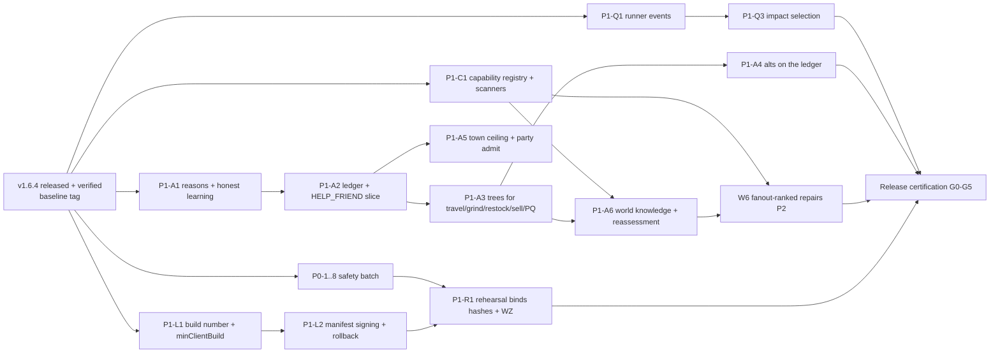

# B. 1.7.0 Implementation Dependency Map

Status: final for sign-off, Nov 5 2026. Ticket ids are from C.

**Start condition:** 1.6.4 released and verified on live. The released commit is tagged `v1.6.4`, and
`release-1.7.0` branches from that tag. Nothing below starts earlier.

## Phases

| Phase | Contents | Exit |
|---|---|---|
| Now | 1.6.4 only: release checks, owner-approved deploy, live verification, `v1.6.4` tag | 1.6.4 verified on live |
| 1.7.0 Foundation | P1-Q1, P1-A1, P1-A2 (HELP_FRIEND slice), P0 batch incl. the operation journal | slice checks PASS on TEST; P0-1/P0-2 journal + reconcile proven |
| 1.7.0 Expansion | P1-A3 (trees, handshakes, settling), P1-A4 alts, P1-A5, P1-A6, P1-C1, W6 repairs, P1-L1/L2 | migrated-adapter coverage reported; capability report published |
| 1.7.0 Certification | GP1-GP12, safety fault tests, full-population 24 h soak, client compatibility, manifest verification, restore and rollback proof (incl. memory round trip) | G0-G5 green with evidence |

## Workstreams

| W | Owner lane | Tickets | Measurable outcome | Done when |
|---|---|---|---|---|
| W0 QA platform | Server Dev + client lane | P1-Q1, P1-Q2, P1-Q3 | zero lost events in the two-signal regression; every merge gets a selection record | runner test passes; 3 merges selected correctly; VM run on the release client |
| W1 Bot runtime | Server Dev (single owner of `action/`) | P1-A1..A6 | started-root terminal-within-deadline at least 99.9% on TEST over 24 h; zero illegal transitions; zero duplicate terminals | slice checks PASS; 24 h soak numbers in the book |
| W2 Engine/content inventory | Server Dev, helpers for scanners | P1-C1, P1-E1 | capability report with fanout on the baseline; map loads survive bad life rows | report published; scanner in L0 |
| W3 Safety | Server Dev, helpers per ticket | P0-1..8, P1-E2 | every P0 has a fault-injection test that fails before the fix | all P0 `fixed` with proofs |
| W4 Integration | launcher + site lanes | P0-7, P1-L1, P1-L2, P1-R1 | mismatched/unsigned/old manifest refused; receipt binds hashes | launcher/site tests + RC channel check |
| W5 Docs/coordination | Coordinator | book cards, HOLES updates | every release claim links code, test and artifact | book audit at go/no-go |
| W6 Gameplay Capability Recovery | Server Dev, helpers | P2-W6 + P2 list | golden paths GP1-GP12 pass; each repair lists what it unblocked | all golden paths PASS on the RC |

## Critical path

`S0 -> P1-A1 -> P1-A2 -> P1-A3 -> P1-A4 -> certification`, with `P1-C1 -> P1-A6 -> W6` joining before
certification.

## Runs in parallel from day one

- The P0 safety batch.
- P1-Q1.
- P1-C1.
- P1-L1.

## Shared interfaces (one owner each, versioned)

| Interface | Owner | Consumers |
|---|---|---|
| `action/` types (Attempt, Reason, Resource, Policy), `ActionLedger.transition` | W1 | adapters, learning, alts, QA, dashboard |
| `LifeOutcomes` event shape (adds attempt ids, reason) | W1 | `LifeLearning`, `SocialInitiative`, QA |
| `CapabilityVerdict` + `data/capabilities.json` | W2 | W1 (world knowledge), QA, dashboard |
| QA result record (class, capability, selection, attempt ids) | W0 | test-status, book, release receipt |
| Release manifest fields (`minClientBuild`, signature, version) | W4 | launcher, publisher, rehearsal |

**Concurrency rule:** only W1's owner edits `action/` and `LifeActivityQueue`. Helpers work on P0, scanners, launcher
and site tickets in their own worktrees (house rule: never two agents on one core interface).
